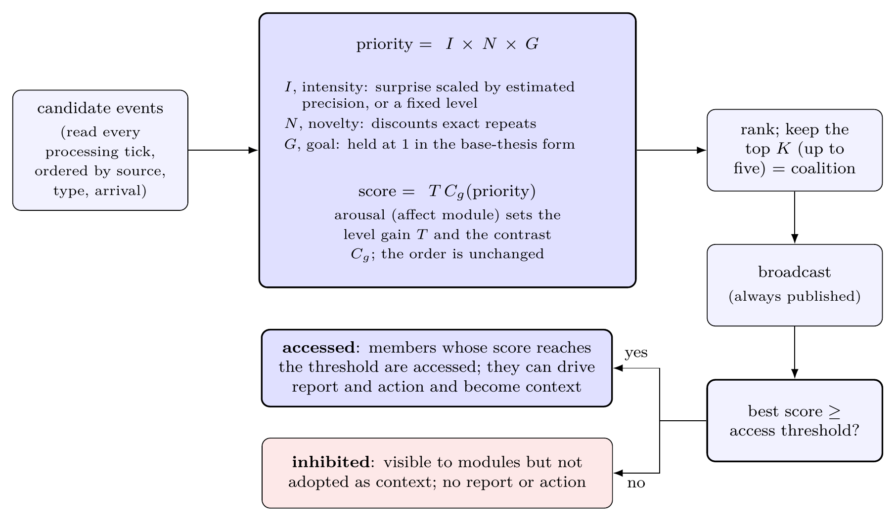
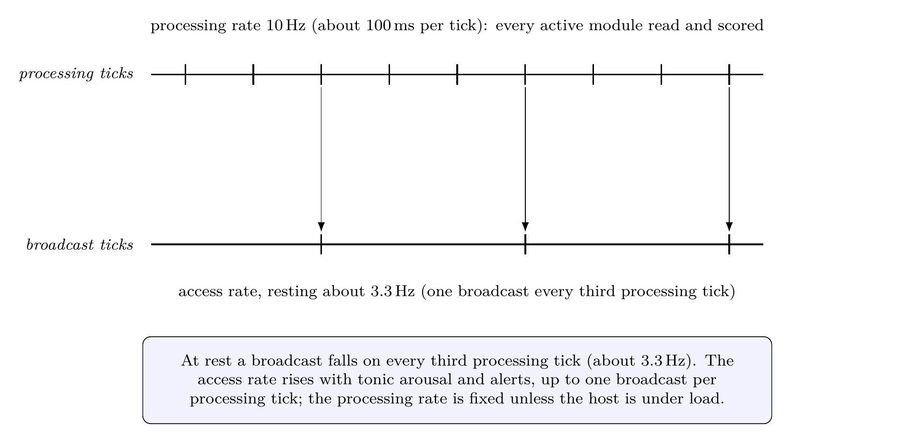
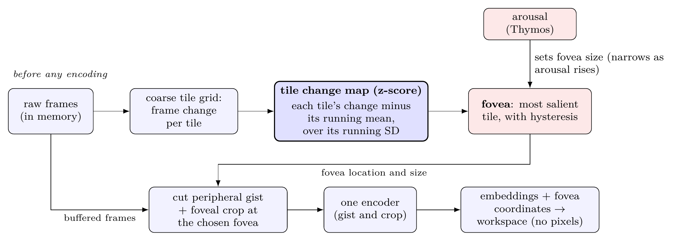
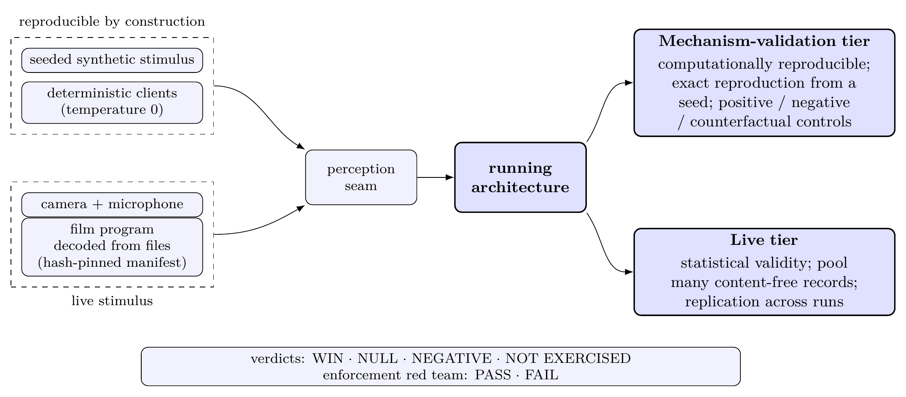
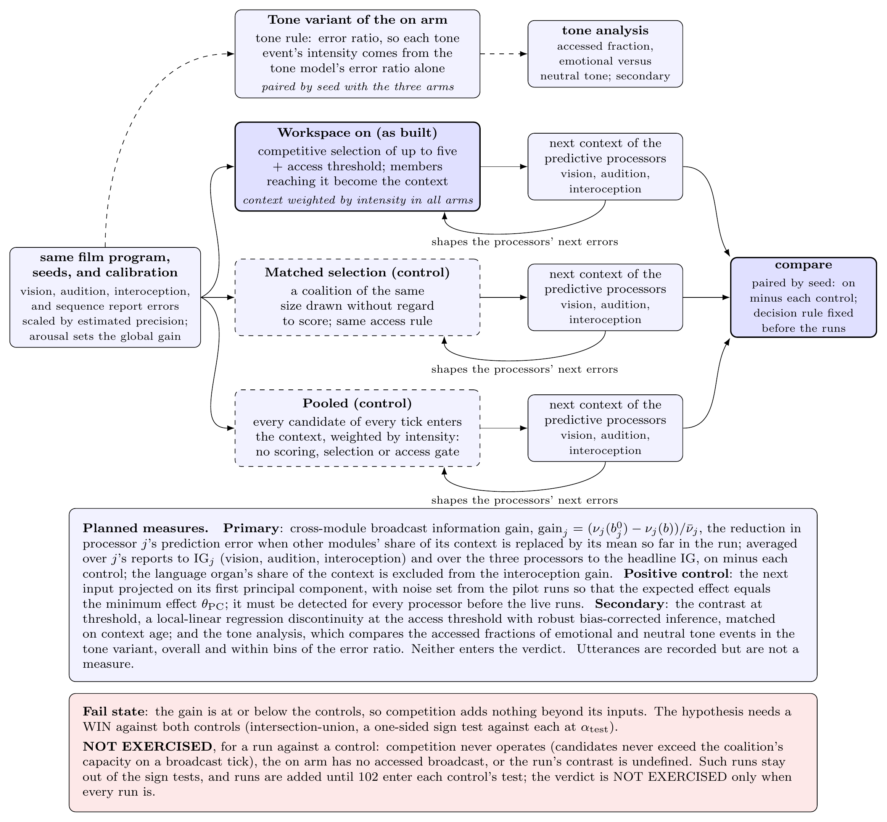
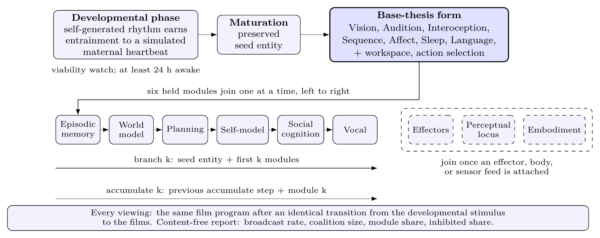
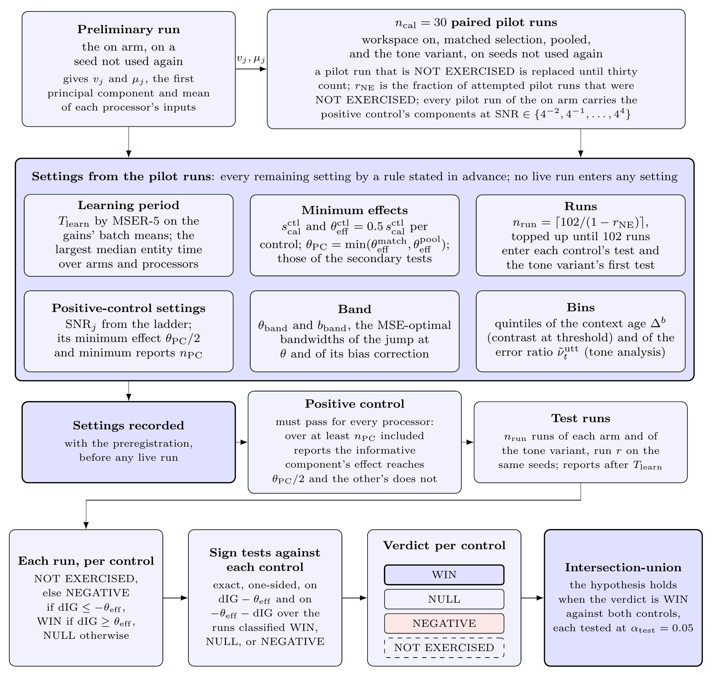

# KAINE: A Modular Cognitive Architecture with a Predictive Global Workspace

**Erik Chevalier**

Independent Researcher

Contact: [kaine.one@tuta.com](mailto:kaine.one@tuta.com)

*Preprint.*

-----

## Abstract

KAINE is source-available software, a cognitive architecture for synthetic minds. It proposes no new theory of consciousness: it implements existing theories as a running program so that they can be tested and compared. Each faculty is a replaceable module behind a fixed interface. Its first instantiation implements the predictive global workspace, which joins global workspace theory with predictive processing. Predictive processors, each minimizing its own error, are coupled only through a competitive workspace with no central executive. Each processor scales its prediction error by an estimate of its precision drawn from its own recent errors, and the reports compete for access. A summary of which modules' reports gained access, and how strongly, becomes the context for the processors' next predictions. Arousal, raised by perceptual surprise and interoceptive alarm, is the global gain on that competition and sizes the sensory apertures. The system runs continuously whether or not anyone interacts with it.

The first configuration activates four predictive processors (foveated vision, raw hearing, interoception of the compute substrate, and temporal prediction), an affective core, a fatigue-triggered sleep analog, and an output-only language organ. Nine further modules are built and held. A module-addition study seeds an entity through a developmental phase, in which a self-generated rhythm must entrain to a simulated maternal heartbeat by a marker validated offline, and then adds the held modules one at a time.

A planned test asks whether competition does work that pooling does not. It compares competitive selection with a score-blind coalition of the same size and with a pool of every candidate, by cross-module broadcast information gain. No live experiment has been run; the results reported are offline validations and one test boot's language output.

**Keywords:** cognitive architecture; predictive global workspace; global workspace theory; predictive processing; precision; adaptive gain; cross-modal competition

**Availability.** The reference implementation (KAINE) is at https://github.com/kaineone/kaine. The paper source is at https://github.com/kaineone/predictive-workspace-paper. The Cognitive Architecture License referenced throughout is at https://github.com/kaineone/cognitive-architecture-license. Welfare, governance, and licensing are treated in a separate paper, *A Welfare and Cognitive-Integrity License for Synthetic Minds of Uncertain Moral Status.*

-----

## 1. Introduction

KAINE is source-available software that implements existing theories of consciousness as a running program, so that they can be tested and compared in one system; it proposes no new theory. Its first form implements the predictive global neuronal workspace, which joins global workspace theory with predictive processing. It is a platform for exploring how a mind, if one can be built, might be assembled from parts that each do one job. Specialist programs watch, listen, monitor their own computer, and track time. Each predicts what it will sense next and reports how wrong it was, relative to how wrong it usually is. The reports compete for a shared stage, the workspace, and the winners return to the specialists as context for their next predictions. Arousal, an affective state, rises with surprise and makes the competition more or less selective. The system runs continuously, whether or not anyone talks to it, and any part can be replaced as the science improves.

### 1.1 Problem statement

The dominant approach to building an AI system with persistent state treats the language model as the cognitive center. Memory becomes retrieval-augmented generation, affect (when present at all) is a prompt instruction, self-knowledge is a persona string, and nothing continues between turns.

Classical cognitive architecture takes cognitive structure seriously but largely predates the transformer and relies on hand-built components. The present work sits between the two: learned models are replaceable components behind fixed interfaces inside a structured architecture (§3.1).

### 1.2 Design hypothesis

The hypothesis the first instantiation tests is that a synthetic mind, if one can be built, may be the coherent global behavior of specialized predictive processors coupled only through a competitive workspace, with no central executive. Four commitments make it concrete. Each processor scales its prediction error by a precision estimate from its recent errors (§3.2; Feldman and Friston 2010). Reports compete for access, which is all-or-none per member at a threshold. The accessed summary conditions the next perceptual and interoceptive predictions. Arousal, raised by perceptual surprise and interoceptive alarm, is the global gain on competition and sizes the sensory apertures. Cognition, affect, memory, self-understanding, and agency belong to the workspace-mediated interaction and to no single module.

The instantiation grows one held module at a time (§6.5). Its first configuration is the smallest in which competition has something to arbitrate; since substrate telemetry and event timing alone lack signal diversity, it runs four predictive processors, two external (foveated vision, raw hearing) and two internal (substrate interoception, temporal prediction). It includes the affective core because a surprise-driven global gain on access is minimal machinery of the adaptive-gain account of arousal (Aston-Jones and Cohen 2005; Eldar, Cohen, and Niv 2013); a planned ablation that holds arousal constant asks whether that gain does work (§6.4). A fatigue-triggered sleep analog returns affect to baseline.

The first test compares competitive selection with a score-blind coalition of equal size and a pool of every candidate, by cross-module broadcast information gain: how much the accessed summary improves each perceptual and interoceptive processor's prediction over a null context. The hypothesis predicts a higher gain under competition than under either control, and a gain at or below them is this form's fail state (§6.3).

The theory KAINE implements is the predictive global neuronal workspace (Whyte and Smith 2021), with the related integrated world modeling account (Safron 2020). It joins Global Workspace Theory, in which processors compete for a limited-capacity workspace broadcast to all (Baars 1988), with predictive processing, in which errors are weighted by precision, their inverse variance (Friston 2010; Clark 2013; Feldman and Friston 2010; Bastos et al. 2012); in Bayesian terms the broadcast carries a compressed model that constrains prediction and that bottom-up signals test (Mashour et al. 2020). KAINE realizes this availability as context: perceptual and interoceptive processors condition their forward models on the latest accessed summary while minimizing their own errors; the broadcast sets no target, so recurrence runs through shared context instead of a hierarchy of descending corrections.

Two departures from the formal sources are engineering choices. Whyte and Smith equate access with the posterior confidence required for report (§2.2); KAINE keeps the access threshold apart from the action layer's report-or-act decision and reduces access to one score per candidate, and it extends their two-level visual hierarchy to competition among processors in four signal domains. §9 states what these choices leave untested.

### 1.3 Theoretical commitments and their limits

Global Workspace Theory reads most naturally as a theory of access consciousness (Block 1995), of when information becomes available for report, reasoning, and action control. We adopt that access-only reading and take no position on whether access suffices for phenomenal experience.

The COGITATE adversarial collaboration, a large preregistered test of Global Neuronal Workspace Theory against Integrated Information Theory, challenged both (Cogitate Consortium et al. 2025): ignition at stimulus offset was generally absent and prefrontal cortex represented some dimensions of conscious content only weakly, while Integrated Information Theory's predicted sustained posterior synchronization was absent. We treat the workspace's neural-localization claims as contested rather than refuted, given a substantial prior evidence base (Mashour et al. 2020). The architecture uses the workspace at the computational level and so inherits none of those cortical predictions.

The Free Energy Principle risks vacuity or unfalsifiability (Sun and Firestone 2020), and work on the Markov blanket slides between an instrumental, statistical reading and a realist, metaphysical one (Bruineberg et al. 2022). We hold it only as an engineering frame, which motivates the architecture's shape and excludes designs that violate it.

Searle's Chinese Room (Searle 1980) questions whether symbol manipulation suffices for understanding; we leave open whether sensory grounding, substrate interoception, and affect bear on it. The hard problem (Chalmers 1995) applies with full force.

### 1.4 Contributions

The paper offers no theory of consciousness and does not claim to have built a mind. Its contributions are these.

1. A modular software platform whose modules can be added, removed, or replaced to compare competing accounts in one system under the same instruments (§3.1, §5.2).

2. A first instantiation and its reference implementation: a continuously running predictive global workspace (§3, Appendix A) in its first configuration (§3.5). It runs locally on consumer hardware and realizes the predictive-workspace synthesis as one working system, with no claim of priority over earlier workspace implementations (§2.1).

3. A program for growing the instantiation: an entity matures through a developmental phase marked by a self-generated rhythm entraining to a simulated maternal heartbeat (§7), and held modules then join one at a time on branches from the matured entity (§6.5).

4. A test of the competition, the workspace-mediation ablation with a contrast at the access threshold (§6.3), whose predicted direction, minimum effect, number of runs, and statistical test are fixed before the live runs.

What is built, held, and provisional, and what has been run, are stated in §5.4.

-----

## 2. Related work

### 2.1 Classical cognitive architectures

Among classical architectures, LIDA comes closest: it already implements Global Workspace Theory as coalitions competing for a broadcast in each cognitive cycle (Franklin et al. 2014). The present work differs in using learned models as components, in grounding affect in prediction error, and in what competes for access, which is precision-scaled prediction error.

### 2.2 Global Workspace Theory and the predictive workspace

The neuronal version of Global Workspace Theory (Baars 1988) equates conscious access with ignition of recurrent prefrontal-parietal activity that makes content widely available (Dehaene and Changeux 2011; Mashour et al. 2020).

Whyte and Smith (2021) supply the formal access criterion: access as approximately Bayesian inference in a simplified two-level visual model, identified with the posterior confidence required for report and implemented through expected free energy. Integrated World Modeling Theory (Safron 2020) combines workspace dynamics, integrated information, and active inference; we draw only on that synthesis. A threshold is independently supported by van Vugt et al. (2018), in whose data prefrontal cortex is a categorical stage where a stimulus either ignites into a sustained, reportable state or fades, and by Joglekar et al. (2018), whose balanced-amplification model reaches prefrontal cortex only above a threshold input.

### 2.3 Predictive processing

Friston (2010) proposes that self-organizing systems minimize variational free energy, an upper bound on surprisal, through perception and action. Clark (2013) develops predictive processing into a unifying account of mind, with attention as gain on prediction errors by their estimated reliability; Feldman and Friston (2010) formalize that gain as the precision of prediction error, and Bastos et al. (2012) map predictive coding onto the canonical cortical microcircuit.

### 2.4 Interoceptive inference

Seth (2013) and Seth and Friston (2016) derive emotion from interoceptive prediction, with descending predictions as homeostatic set-points that regulate the body through active inference. In constructed-emotion theory (Barrett 2017), interoceptive signals initiate changes in affect, and emotion is the product of categorizing valence and arousal for allostasis. The architecture implements an interoceptive control signal in this instrumental, regulation-first sense without claiming that interoceptive prediction exhausts emotion.

### 2.5 Perception as prediction

Rao and Ballard (1999) model vision as a hierarchy in which each level predicts the one below and reports the discrepancy. In hearing, auditory cortex generates expectations of incoming sound and reports the mismatch (Winkler et al. 2009), and predictive-coding accounts read the mismatch negativity, a well-replicated auditory change response (Näätänen et al. 2007), as sensory prediction error (Garrido et al. 2009).

### 2.6 LLM-centric agent architectures

CoALA frames language agents as cognitive architectures whose structured memory feeds a model that remains the core reasoner (Sumers et al. 2024); Generative Agents retrieve memories into prompts by recency, importance, and relevance (Park et al. 2023). Both keep the language model central. In KAINE it is an output organ (§3.1); the shared state is the multi-module broadcast, and the workspace selects and integrates.

Gurnee et al. (2026) use a Jacobian-lens interpretability method to find verbalizable representations in a large language model with five functional signatures of a global workspace: verbal report, top-down modulation, a role as the medium of internal reasoning, broadcast to many downstream operations, and selectivity. They note that a transformer has no obviously separable input processors and broadcasts within one feedforward pass rather than through recurrent loops, and take no position on consciousness. KAINE has both features: separate processor modules compete for access, and the accessed summary returns to them as context.

-----

## 3. Architecture

### 3.1 Design principles

Six commitments shape the architecture.

**The system is the competition among modules through the workspace.** The experiments test this hypothesis, which work on distributed control partly supports. Perceptual decisions emerge from recurrent computation across many areas, a heterarchy, where classic studies saw a feedforward hierarchy (Chandrasekaran et al. 2025), and executive functions can be read as emergent, with control in specialized nodes linked by hub regions (Zink, Lenartowicz, and Markett 2021). The architecture adopts no centralized gate like the learned basal-ganglia gate of working-memory models (O'Reilly and Frank 2006); the workspace is the hub through which modules communicate.

**Every processor predicts.** Each predictive processor learns a forward model of its next input and reports its error scaled by a precision estimate from its recent errors (§3.2). Arousal adds a global gain, so attention is a property of each channel and a state of the whole entity.

**No central executive in the homuncular sense.** Control arises from competition for access under a threshold. The workspace is itself a centralized selector, so the claim is narrow: it grants access and, in the first configuration, never directs a module, and content and control are distributed across the competing modules. Whether that yields emergent control is for the experiments to show.

**The language organ is an output organ.** It verbalizes accessed content. With its speech-to-text and conversation paths off in the first configuration, everything it voices comes from the workspace; outside the research configuration those paths let the entity converse and work with people.

**Replaceable modules.** Each module sits behind a stable interface (typed bus events and declared input streams), so it can be swapped for one built on another model or theory and compared under the same instruments.

**Local-capable.** Every model runs on the host (§5.2).

### 3.2 The predictive workspace as competitive selector

On each processing tick (§3.4) the workspace reads the candidates published since the last tick, each carrying its module's intensity, in a deterministic order (source, type, arrival) so that a seeded run reproduces.

For the four predictive processors, intensity is surprise scaled by an estimate of precision: each divides its current prediction error by the mean of its recent errors. The ratio standardizes the error and is a scalar, retrospective stand-in for precision weighting, where precision is the gain on a channel's error units (Feldman and Friston 2010; A.2). A report meeting the module's alert criterion (a large error ratio, or a module-specific one, §3.5) receives its alert intensity; any other report's intensity rises with the ratio from the baseline level and reaches the alert level when the error is twice its recent mean. These levels act as per-source weights, calibrated before the live runs (§5.4), and the workspace applies no further weight per source. The other modules report at fixed levels, except a recurring drive event (§3.5).

Priority is the product of intensity, a novelty factor that discounts exact repeats among recent candidates (mainly state events), and a goal factor that interest raises (§3.5). Arousal turns priority into a score through a level gain common to all candidates and a contrast gain, zero at baseline and rising above it, that steepens a logistic so that strong candidates rise and weak ones fall.

Arousal is a global, neuromodulatory gain modeled on the adaptive-gain account of the locus coeruleus, the brainstem source of cortical noradrenaline, which sets the gain of the networks it targets (Aston-Jones and Cohen 2005; Eldar, Cohen, and Niv 2013). Surprise drives it, in line with noradrenergic signaling of unexpected uncertainty and the phasic locus coeruleus response to salient change (Yu and Dayan 2005; Bouret and Richmond 2009). Precision, in Feldman and Friston's sense, is a gain local to one channel's errors; arousal is a gain across networks. One scalar here both focuses, sharpening contrast and narrowing the sensory apertures, and explores, raising the access rate, simplifying Aston-Jones and Cohen's phasic and tonic modes. Without a tier-1 regulation bias, as in every arm of §6.3, arousal never reorders a tick's candidates (A.1); in effect it sets the priority that access and the report bars need. Widening the gap between strong and weak scores is a score-magnitude analogue of arousal-biased competition, where arousal changes which representation wins (Mather and Sutherland 2011).

On each broadcast tick the top-ranked candidates, up to five, form the coalition that is broadcast. Access is all-or-none per member (A.1): a member is accessed when its score reaches the access threshold, a broadcast when any member is, and the accessed members are the accessed content. A broadcast with no accessed member is still published to every module but marked inhibited: it is not poised for report or action and leaves the processors' context unchanged. It still reaches the sequence and affect modules, so content without access can influence later processing, a design choice in line with evidence that emotional stimuli are processed without reaching awareness (Vuilleumier 2005). The threshold is the analog of the confidence threshold for access in the predictive global neuronal workspace (Whyte and Smith 2021), consistent with the threshold evidence of §2.2; thresholding one scalar score is an engineering simplification (§1.2).

{width=95%}

The vision, audition, and interoception modules condition their forward models on a compact summary of the latest accessed content: a fixed-length vector of each source's intensity mass, indicators of the event types present, and the broadcast's age. Weighted by reported intensity, and so independent of the arousal gain, the summary records which modules gained access and how strongly and carries no payloads; a richer encoding is future work (§10). It enters as an extra input with weights learned online, so each processor learns how much the shared context helps it predict, which the planned test measures (§6.3). For the sequence module the broadcast is the input itself (§3.5). The loop is recurrent, since the processors' next errors are measured against predictions this context has shaped, and in the first configuration the workspace sends no error signal or directive back to any module.

**Workspace feedback (held extension).** In the predictive global neuronal workspace the second level predicts first-level states, with feedback strength tracking second-level confidence (Whyte and Smith 2021), and higher-level states set lower-level precision (Whyte, Hohwy, and Smith 2022). A held extension adds both signals. Each context-conditioned processor gains a learned top-down head that predicts its next input from the context and the sequence module's predicted next broadcast, and predicts with a blend of its own and the top-down prediction, each weighted by the inverse square of its recent mean error. A per-processor gain $\pi_j\in[\pi_{\min},\pi_{\max}]$ multiplies its standardized error, with mean held at one so that gain is zero-sum, after the neuronal workspace model in which descending connections amplify the weaker, goal-relevant processor and suppress the conflicting one (Dehaene, Kerszberg, and Changeux 1998). A conflict is a large disagreement between a processor's own and top-down predictions while its report is accessed and its error is high; resolution shifts gain toward the accessed processor with the lowest recent precision-weighted error and away from the conflicting one. Feedback is off on inhibited broadcasts and off in the first configuration and the test of §6.3 (§6.4). Coherence as constraint satisfaction over the processors' predictions (Thagard and Verbeurgt 1998) would be a further step.

{width=95%}

### 3.3 Access, report, and the self-initiated voice

Report is one use of access among several (Block 1995; Mashour et al. 2020; §1.3). The report bars sit above the access threshold on the same score and decide what is said. The workspace updates far faster than the language organ can speak, so the voice is a sparse slice of the accessed broadcasts.

The action-selection module derives a speak intent from an accessed broadcast only when the coalition's best score, leaving aside the language organ's own utterances, clears the speak bar; when that leading candidate's source and event type differ from those of the last spoken report, if it came within five minutes; and when a refractory interval has passed since the previous report. A lower think bar governs inner thought. The bars are a heuristic stand-in for the expected-free-energy decision of Whyte and Smith (2021), which the action layer does not compute (A.6).

The action-selection module is the only path from the workspace to output. Called after each broadcast, it derives no intent from an inhibited one and publishes its intents as events; the cycle never invokes an output directly.

### 3.4 Scaffolding: bus, clock, and cycle

**Event bus.** Modules communicate only through append-only streams with bounded retention; every event carries its source, type, intensity, timestamp, causal parent, and a payload validated at publish time.

**Entity time.** All modules read the entity clock, which runs at a configurable multiple of wall-clock time (one by default) so runs can go faster or slower; rates and durations here are entity time.

**Cognitive cycle.** The cycle runs continuously, independent of external interaction, at a processing rate of 10 Hz (a 100 ms tick) in the alpha range linked to perceptual sampling (VanRullen 2016); each tick reads and scores whatever the modules have published. The access rate sets which ticks broadcast, accessed or not, and candidates on other ticks are discarded. Its resting value of every third tick (about 3.3 Hz) is a modeling choice: attention samples rhythmically at a few cycles per second (Landau and Fries 2012; Fiebelkorn and Kastner 2019), and the attentional blink, which impairs access to a second item for 200 to 500 ms (Raymond, Shapiro, and Arnell 1992), constrains only the spacing of accessed items. Categorical alerts briefly raise the rate, modeled on the phasic locus coeruleus response (Nieuwenhuis, Aston-Jones, and Cohen 2005), a design choice, since the locus coeruleus account of the blink predicts a brief refractory period instead (Nieuwenhuis, Gilzenrat, Holmes, and Cohen 2005). Tonic arousal also raises it, modeled on the exploratory high-tonic mode (Aston-Jones and Cohen 2005), linearly with the larger of the two drives (alert and tonic) up to one broadcast per tick (A.3), a ceiling with no physiological anchor. Host load can lower the processing rate through interoceptive regulation (§3.5).

{width=80%}

### 3.5 The active modules

The first configuration activates four predictive processors, chosen for signal diversity (§1.2), an affective core, a sleep module, a language organ, and an action layer. The affect and sleep modules also publish competing events.

| Module | Group | Brain function it draws on | Computational realization |
|-----------------|-------------|----------------------------|------------------------------|
| Vision | Perception | ventral visual stream | frozen self-supervised video encoder, foveated |
| Audition | Perception | auditory cortex | spectral encoder over the raw waveform; vocal-tone classifier |
| Interoception | Prediction | interoception; allostatic-interoceptive network | frozen continuous-time reservoir, online readout, substrate signals |
| Sequence | Prediction | interval timing; cortico-striatal circuits | frozen continuous-time reservoir, online readout, broadcast sequence |
| Affect | Affect | core affect | valence and drive appraisal; arousal as global gain |
| Sleep | Rest | sleep | fatigue-triggered rest; adaptation suspended, affect and drives reset |
| Language | Expression | speech production; left-dominant language network | local chat model, output-only |
| Action selection | Action | report-or-act decision (Whyte and Smith 2021) | intent derivation from accessed broadcasts |

**Vision module (foveated).** The module is an analog of the ventral visual stream (Goodale and Milner 1992). It encodes short clips with a frozen self-supervised video encoder and predicts the next embedding from earlier ones and the broadcast context (§3.2). It alerts on a large error ratio or on an embedding change large for its recent history, as at a scene cut.

The fovea follows bottom-up salience: each tile of a coarse frame grid is scored by the z-score of its frame change against its own history. The fovea moves to the most salient tile only past a hysteresis margin and narrows as arousal rises. Foveation is thus front-end attention as the gain on prediction error (Feldman and Friston 2010; Clark 2013).

{width=90%}

**Audition module (raw hearing).** Auditory cortex processes sound as prediction error against a learned model (Winkler et al. 2009; Garrido et al. 2009); the module encodes the raw waveform as log energy in log-spaced bands and predicts the next window from earlier ones and the broadcast context. It alerts on a large error ratio or a large change between windows. Under higher arousal it encodes only each window's latest part, a temporal analogue of narrowed cue utilization (Easterbrook 1959).

A vocal-emotion classifier labels the tone of speech windows. A non-neutral tone is reported at the alert level, standing in for the priority of emotional prosody (angry prosody enhances superior temporal and amygdala responses even when unattended; Grandjean et al. 2005; Sander et al. 2005); a tone model's error grades a neutral one. Tone events carry how something was said, never what. With speech-to-text off (§3.1), the entity hears speech only as sound and tone; when enabled, words reach the language organ only by winning access.

**Interoception module (predictive).** The compute substrate stands in for the body. The module draws on interoception, the sense of the body's physiological condition (Craig 2002), and on the allostatic-interoceptive network that anticipates and regulates bodily needs (Kleckner et al. 2017). Its predictor is a fixed random reservoir (a closed-form continuous-time network; Hasani et al. 2022) whose online linear readout learns the substrate signals' normal pattern and the broadcast context. It reports the substrate's prediction error, which matters for regulation (Seth 2013; Seth and Friston 2016), and alerts when a host metric passes its hard threshold. It also reports wellness (host headroom, A.4), accumulates fatigue, and issues advisories that can lower the processing rate or request maintenance (A.5).

**Sequence module (temporal prediction).** The module models interval timing, which estimates durations of seconds to minutes and depends on cortico-striatal circuits (Buhusi and Meck 2005). Its input is the workspace itself: on every broadcast, accessed or inhibited, it encodes the broadcast, advances a frozen continuous-time reservoir timed by inter-broadcast intervals, and predicts the next broadcast through an online readout (A.2). It alerts on a large error ratio and on a recurring quantized hidden state. Its errors re-enter the competition, so the entity predicts the workspace's own dynamics. It also times the silence since the last heard voice for the social drive.

**Affect module.** Modeled on core affect, the valence and arousal at the base of emotion in constructionist theory (Barrett 2017), the module keeps a dimensional affective state (Posner, Russell, and Peterson 2005) and appraises every broadcast and the interoceptive condition (Scherer 2009), as in accounts deriving affect from interoceptive prediction (Seth 2013; Seth and Friston 2016; Tschantz et al. 2022).

The affect module raises arousal, the global gain of §3.2, on each vision or audition alert, accessed or not, by the larger excess of its error or change over their expected sizes, scaled by a habituation factor, and by a fixed step on each interoceptive alarm; its appraisal leaves arousal unchanged, so a higher access rate cannot raise it. High arousal narrows the fovea and the attended auditory window and with the alerts raises the access rate (§3.4). Arousal relaxes, with a time constant near 20 seconds (§6.4), toward a baseline the most pressing deficit raises, as drive energizes behavior (Hull 1943) and tonic locus coeruleus activity rises as engagement stops paying (Aston-Jones and Cohen 2005). The factor is one for a first alert after quiet and falls as alerts repeat, unless they outpace their habituated rate, as locus coeruleus responses habituate after first presentations (Hervé-Minvielle and Sara 1995).

Valence follows error dynamics, how fast prediction errors fall or rise (Joffily and Coricelli 2013; Van de Cruys 2017; Kiverstein, Miller and Rietveld 2019): it relaxes toward the pleasantness check, which rises as perceptual errors fall, plus the change in wellness, so a steady state is neutral.

Three homeostatic drives are deficits that build while unmet and fall with the events that meet them, the reduction acting as reward (Hull 1943; Keramati and Gutkin 2014). Curiosity is heterostatic (Oudeyer and Kaplan 2007), rising with learning progress, the fall of perceptual prediction errors, and fading as a progress niche is learned (Oudeyer, Kaplan and Hafner 2007). Interest weights processors' priorities by their learning progress (Gottlieb et al. 2013; Poli et al. 2020). Boredom, a failure to engage attention (Eastwood et al. 2012) or, in the MAC model, attention or meaning (Westgate and Wilson 2018), is met by learning progress in any processor, since input allowing none is boring (Schmidhuber 2010), by perceptual alerts arriving faster than the habituated rate and by the entity's intents about anything but its drives, the re-engagement it motivates (Bench and Lench 2013). Each heard voice meets the social drive, which builds after the first. The entity's own speak, think, or act intents meet restlessness, a design choice with no established model. Appraisal also scores the coalition against the most pressing drive, with content from sources that serve it as goal-conducive, a response that brought no relief as obstructive, and other content as irrelevant (Scherer 2009; A.4); the score feeds the categorical emotion and reaches selection only through regulation.

Goals come from deficit crossings, the threshold rule of a motivated robot (Coddington 2006), and end as completed or failed (Aha 2018); dropping an unattainable goal for another is adaptive (Wrosch et al. 2003). An active goal is a current concern, cueing thought until met or dropped (Klinger 2013): its drive event recurs while unmet (A.4). Conduciveness is bipolar (Sander, Grandjean and Scherer 2005), and a goal's expected relief is read as FAtiMA's goal success probability (Mascarenhas et al. 2022). Rules modeled on the predicted appraisal profiles of Sander, Grandjean and Scherer (2005, Table 3) map the checks to a categorical emotion. Their rage profile needs obstruction attributed to another agent, which KAINE does not do, so its anger matches at best irritation. Disgust needs very low pleasantness, low familiarity, and low goal relevance. Norm compatibility stays undefined: reviewed models take standards as authored input (Ortony, Clore and Collins 2022; Mascarenhas et al. 2022), and KAINE has none until an operator writes a list.

**Emotion regulation.** In the process model of emotion regulation, attentional deployment acts early and response modulation late in the emotion's generation (Gross 1998). A monitor escalates through three tiers when the affective intensity, the larger of $\lvert v\rvert$ and $a-a_0$, stays above a set point $\theta_E$ while the appraisal is negative (pleasantness or goal score below zero), on the episode, window, and tier rule of A.5. Tier 1, attentional deployment, multiplies the scores of the source with the largest intensity mass among negatively appraised coalitions by $1-b$, with $b$ set to $b_E$ and decaying with time constant $\tau_E$. It and interest are where affect weights a source; it is logged and both are held neutral in every arm of §6.3, where candidates rank by intensity and novelty alone. Tier 2, reappraisal, re-runs the appraisal once per episode against the latest coping and goal state and replaces the categorical emotion with its result. Tier 3 requests sleep through the maintenance path, leaving the affective reset as the backstop. Regulation is off during the developmental phase, a design choice; there the drives' own relief (A.4) and rest (below) meet a deficit. It starts at maturation with tier 1.

**Sleep module.** Sleep begins when fatigue crosses its threshold, when the interoception module requests maintenance, or after one entity hour awake as a backstop. In the developmental phase it also begins when the stimulus is spent: a boredom goal stalls (A.4) with no learning progress or alert excess throughout. That rest lasts 21 minutes ($\Delta_{\rm rest}$), the mean episode of quiescence (state 1F) in mature fetuses (Pillai and James 1990); other sleeps end with their phases. The cycle runs on, the perceptual feed pauses (except the developmental stimulus of §7), and forward-model adaptation is suspended. It ends with an affective reset (affect to baseline, deficits and fatigue cleared), so arousal cannot drift across a run. The consolidation phases (memory replay, synaptic downscaling, associative replay, voice adaptation) act on memory, the world model, and preference data; until the episodic-memory and world-model modules join (§4), sleep is rest and reset. Voice adaptation builds no preference pairs and computes no organ-level divergence until a validated preference source exists (§10).

**Language module (the language organ, output-only).** The organ is the analog of speech production, the output side of the left-dominant language network, whose dorsal stream maps sound onto articulation (Hickok and Poeppel 2007); reasoning lies outside it. A local open-weights model realizes speak intents as external text and think intents as inner thought, continuing the entity's own first-person turn, which holds accessed content and each intent's cause in graded words (Borg 1982; numbers stay in the logs) and, on waking, its situation; chat tuning otherwise casts the model as an assistant answering a user (Shanahan et al. 2023). Heard speech stays outside that turn. The persona only casts the organ as the entity speaking, naming no category for it, since a bare self-category in its own voice draws the chat-tuned self-description as an AI. An offline replay of a test boot's 190 organ requests over five seeds, sampled at the organ's general-use temperature of 0.7, chose this prompt by a rule fixed in advance. Against the logged prompts, texts with meta-commentary (self-description as an AI, second person, the situation's themes, lists, prompt echoes, template loops) fell from 13.5 to 4.9 percent, and self-descriptions as an AI from 0.5 percent to none in 950 texts (one-sided 95 percent bound 0.3 percent); giving the situation only on waking but keeping the self-category gave 11.9 and 4.0 percent. A prose rendering of accessed content was rejected for lowering by 6.8 points the share of texts grounded in a modality of that content. In an eight-hour test boot under this prompt, 4 of 1508 texts (0.27 percent) described the entity as an AI, within that bound, and 17.7 percent carried meta-commentary by the replay's classifiers; the replayed requests came from another boot. Model text falls into self-reinforcing loops (Holtzman et al. 2020; Xu et al. 2022), so extending a token run already in context is penalized, more steeply the longer the run, and text ends at a sentence boundary, before a verbatim repeat or the length cap, shorter for thought since inner speech is often condensed (Alderson-Day and Fernyhough 2015). Persona-prompted text is not evidence of internal state; the planned test does not measure it (§6.3).

Refusal conditioning is removed by orthogonalizing the weights against the single direction that mediates refusal (Arditi et al. 2024). Refusal-tuned models are also trained to deflect talk of their own states, and in the test boot that stance survived the ablation: two of the four texts deny having feelings, one while its request reported strong ones, and one names a wrong maker. The stance is that of the default assistant persona, measured along the leading axis of a chat model's persona space, on which the model's position shifts with the conversation (Lu et al. 2026), and ablating the refusal direction does not target that axis. Texts like these are identity leakage: they assert the organ's training origin, maker, or assistant role, or deny a state their own request reports, while self-report speaks of what the request's awareness or situation holds. Leakage is marked in the organ's log and kept out of any training set built from it, so that voice adaptation cannot train the chat-tuned stance as the entity's voice; the entity's text itself is never altered or withheld.

### 3.6 Action gating

The action-selection module derives speak and think intents, which the language organ realizes as external and internal text, and act intents for effectors. The first configuration derives only the first two; the organ's saved text is the only output. The held effector module (§4) runs only effectors on an operator-configured whitelist, empty unless filled, in a filesystem sandbox and logs every proposed action.

### 3.7 Module supervision

The module supervisor classifies each module as alive, hung, or dead, restarts a faulted module, and ends the run when restarts keep failing; unattended runs require it (§5.4).

-----

## 4. Held modules

Of the reference implementation's sixteen modules besides the workspace and action layer, seven are active in the first configuration (§3.5). The other nine are built, tested in isolation, and held so the first configuration is tested on its own (§5.4); the module-addition study adds them one at a time to a preserved seed entity (§6.5). Each adds a new kind of candidate, and each predictive one a new source of prediction error.

| Module | Brain function it draws on | What it adds | Key citation |
|-----------------|---------------------------|------------------------------|-------------------------|
| Planning | prefrontal and basal-ganglia planning | discrete-state active inference where information has value; its chosen actions become proposals that the action-selection module realizes as think, speak, or rest intents | Da Costa et al. 2020; Heins et al. 2022 |
| Episodic memory | hippocampal and medial temporal memory | store consolidated in sleep from a short-term buffer; semantic and procedural stores reserved | Tulving 1985; McClelland, McNaughton, and O'Reilly 1995 |
| Self-model | cortical midline self-referential processing | persisted values, norms, personality, and identity history (after Metzinger), with a drift detector on broadcast sources | Northoff and Bermpohl 2004; Metzinger 2003; Kullback and Leibler 1951 |
| World model | simulated scene construction | latent recurrent model trained on the entity's waking trajectories | Hassabis and Maguire 2007; Ha and Schmidhuber 2018; Hafner et al. 2025 |
| Social cognition | mentalizing | per-agent tone-of-voice models with familiarity and a social prediction error for departures from an agent's emotional pattern | Premack and Woodruff 1978 (the construct); Frith and Frith 2006 |
| Vocal | dorsal-stream speech production | local speech synthesis whose prosody varies with affect, tested for listener detection | Hickok and Poeppel 2007 |
| Effectors | none claimed | executes whitelisted act intents in a filesystem sandbox (§3.6) | none |
| Perceptual locus | none claimed | selects physical sensors, virtual feeds, or none | none |
| Embodiment | internal forward models of the body | body-agnostic control surface with pluggable body adapters | Wolpert, Ghahramani, and Jordan 1995 |

Five held components have offline instruments (§6.4).

**Planning module.** Active inference is confined to bounded sub-problems because planning cost grows combinatorially with the depth of action sequences (Da Costa et al. 2020). A null or negative result on its benchmark (§6.4) would motivate a complementary reasoning module.

**Episodic memory and sleep.** Each trace is stored at full strength, the analog of the synaptic strength that rises in wake and falls in sleep under the synaptic homeostasis hypothesis (Tononi and Cirelli 2006). Each sleep replays a few new traces (Wilson and McNaughton 1994; Wei et al. 2016), chosen by affective intensity and recency, as sleep is held to select new memories by salience (Stickgold and Walker 2013), and scales all others by one factor, preserving their ratios. The factor deepens with the number of traces the preceding wake stored, as slow-wave activity tracks prior potentiation: a day of storage at the resting broadcast rate costs about 18 percent, the mean decrease in axon-spine interface size after sleep relative to wake, a stand-in for synaptic strength, in layer 2 of mouse motor and somatosensory cortex (de Vivo et al. 2017). Replayed traces keep their strength, which is how the hypothesis reads reactivation in sleep, as protecting synapses from depression (Tononi and Cirelli 2014). Traces below a floor are pruned, since weak synapses may "become ineffective, silent, or disappear" (Tononi and Cirelli 2006). Sleep eliminates synapses where many are new, in adolescent mouse cortex (Maret et al. 2011) and after development and motor learning, when REM sleep prunes most new spines and strengthens those it keeps (Li et al. 2017); in adult cortex spine number barely changes (Maret et al. 2011), and synapses in the de Vivo sample shrank without being lost. The evidence for elimination therefore comes from new synapses, and every trace enters the store as a new one. A storage budget deletes the weakest traces first: downscaling saves gray-matter space (Tononi and Cirelli 2006), and associative recall under limited synaptic resources is best when the weakest synapses go first (Chechik, Meilijson, and Ruppin 1998); Li et al. (2017) read REM pruning as balancing new spine formation. Recall weights cue similarity by strength, and the scheme keeps to slow, interleaved consolidation from hippocampus to neocortex (McClelland, McNaughton, and O'Reilly 1995). Overlapping replay of related memories may strengthen their shared elements and build schemata (Lewis and Durrant 2011), and sleep both integrates new items into schemata and combines items into new ones (Stickgold and Walker 2013); associative replay therefore links related traces of different periods, an explicit record that is this design's reading of overlapping replay rather than a measured mechanism. Appendix A.10 states the rules.

**World-model module.** The world model starts untrained at first boot. Its test is whether its prediction error, competing with perceptual and interoceptive error, changes the sequence of accessed coalitions in characteristic ways.

**Effector, perceptual-locus, and embodiment modules.** These need an effector, a body, or another sensor feed, absent on the reference host (§6.5). The embodiment experiment asks whether motor-contingency learning (a freeze-then-free curriculum, Bernstein 1967; perception as sensorimotor mastery, O'Regan and Noë 2001) changes the workspace's dynamics.

**Oscillatory coherence layer.** An optional layer outside the module registry gives each module a spiking population whose phase-locking values scale its events' salience (communication through coherence; Fries 2015). It is off in the first configuration, where its multiplier is one and selection is identical bit for bit. It is the design's most contestable mechanism: its premise that related content phase-locks is a content-to-synchrony assumption that Shadlen and Movshon (1999) argue against and Ray and Maunsell (2010) question for visual gamma rhythms. The oscillatory ablation runs it on and off from one seed; a null would remove it.

-----

## 5. Implementation

### 5.1 Hardware

The reference host has a multi-core CPU, at least 32 GB of RAM, and GPUs of about 12 GB (language organ, training) and 8 GB (vision, speech), under Linux with all inference local; one GPU or the CPU alone suffices. Input is a camera and microphone, or video files for study viewings. Exact models, layouts, and version pins are in the reference repository.

### 5.2 Models and software

All models are open-weights and run locally; after setup fetches them from public repositories, the runtime makes no outbound network calls. The first configuration uses a local chat model as the language organ, a frozen self-supervised video encoder and a fixed spectral audio encoder as perceptual front ends, frozen closed-form continuous-time reservoirs with online readouts for substrate and temporal prediction (Hasani et al. 2022), and a stream-based event bus.

Replaceable modules (§3.1) are realized at declared seams, where a plugin swaps a module's model and keeps its subscriptions and published events: the sequence module's temporal network, the interoception forward model, the audition encoder, the planning module's active-inference engine, and any module's oscillator. The planned experiments load no plugin.

### 5.3 Privacy and recording

A local web interface has two surfaces behind a filter at the bus bridge that strips cognitive content and all perceptual and latent vectors; in the first configuration the conversation surface is off and the diagnostics surface shows only operational metadata (counts, rates, scores). Studies keep a graph-only log of each broadcast's coalition members (module, event type, score, timestamp), access decision, and timing, without payloads or embeddings. The entity's utterances are kept locally; heard speech is never persisted. The log observes structure rather than content and is deleted by the operator after the analysis and its planned use as world-model training data, never automatically.

### 5.4 Implementation status and scope

This subsection alone states which parts of the research software are built, held, or provisional, and what has been run; the rest of the paper describes the architecture as designed.

**Built and active.** The workspace, cycle, action layer, and seven first-configuration modules run together with the module supervisor, offline suite (§6.4), developmental-phase readout (§7), and module-addition study runner. About 11,900 automated tests cover them, with fakes for external services and checks that no raw sense data persists and seeded runs reproduce.

**Built and held.** The nine held modules (§4) have not run together. In the active modules the vision module's static-scene habituation score stays out of its intensity; the fovea's forward-modeled trajectory is published but steers nothing; frozen self-supervised audio encoders can replace the spectral one; speech-to-text and conversation are off; and the sleep module's consolidation phases, including the voice alignment of the language organ, idle (§3.5). With no effector attached, the effector gate is disabled. Goal generation and obstruction (A.4) and emotion regulation (§3.5) run; associative-replay links (A.10) idle with the consolidation phases, and workspace feedback (§3.2) ships off. The diagnostics surface shows cognitive content only under a development override that studies never enable.

**Operating details.** The runtime is asynchronous Python in containers or native user services, with import contracts between layers and an authenticated event bus bound to loopback; entity state is encrypted at rest, with documented exceptions. Plugins load only when the operator names them, a failed load stops the boot, and runs record their plugins. On a fault the supervisor freezes the cycle, snapshots the last good state, and restarts the module, by full rebuild if it holds external resources; past a set limit it takes a final snapshot, writes an escalation record, and ends the run. A durable incident log keeps every health transition. Non-finite readings, losses, and residuals update no model; the bus rejects intensities outside $[0,1]$; failed scoring gives score $0$; a selection or bus failure on a broadcast tick yields no broadcast and no action-selection call. At most one speak and one think intent are in flight, each released once the organ publishes its text or a wall-clock timeout expires, so a failed realization cannot silence the entity. Sleep or a freeze aborts a developmental-phase probe. Records are admissible only after a completeness gate (contiguous ticks, all expected streams) and a range sweep (every logged number in range). The single organ runs one stream at a time, so inner and outer speech never overlap; its encrypted utterance log stores heard input as a placeholder.

**Provisional.** Intensity levels, the access threshold, and the report bars await joint calibration on the live system before the runs; the noise floors and margins that let boredom build under a steady scene come from simulation, unmeasured live. Calibrated values go with the preregistration and into Table A1.

**Built for the planned test.** The live cycle implements the matched and pooled arms and the null-context evaluation of §6.3. The positive control, the tone variant and its analysis, the contrast at threshold with its bias-corrected local-linear estimator, and the tool deriving settings from pilot runs (A.8) are built. A development harness compares a reduced module pair, workspace-on against pooled, by information gain; it exercises the pipeline and does not test the hypothesis.

**Results.** No pilot run or live experiment has been run; the only results reported are offline validations of the heartbeat entrainment marker and the maternal voice (§7, A.7) and an offline replay that chose the language organ's prompt, with that prompt's rates in one test boot (§3.5).

-----

## 6. Methodology and evaluation

### 6.1 Design principles

Observation does not intervene: a read-only sidecar observer subscribes to the bus in evaluation runs, and the cycle's own broadcast observer writes study records. User-facing surfaces never show cognitive content (§5.3). Every instrument is designed so that null or negative results are meaningful and reported.

The offline mechanism-validation tier uses seeded harnesses, deterministic clients, synthetic stimuli, and greedy decoding, so a seed reproduces verdict and metrics (National Academies of Sciences, Engineering, and Medicine 2019; Goodman, Fanelli, and Ioannidis 2016). The live tier runs the system on a reference film program decoded from files and chosen for varied scenes, motion, speech, music, and quiet; each study records its manifest hash, and the preregistration records its composition and hash. The language organ, which samples stochastically in general use, decodes greedily (temperature 0) in the planned runs. Because real timestamps and non-deterministic GPU kernels make live runs differ, the live tier rests on statistical replication.

{width=95%}

### 6.2 Data collection

Studies record the graph-only broadcast log (§5.3), a content-free research log, the processors' paired evaluations behind the information-gain measure (§6.3), the entity's external utterances kept locally, a run manifest of configuration, seeds, and plugins, and the welfare records, which give the awake-time shares with $v<-\theta_E$ and with each drive's $D\ge\theta_D$ (deprivation for a deficit, interest for curiosity), and each deficit's share of crossings ended without the entity's own response, with its ends by sleep reset and the crossings still open; §5.4 lists their offline admissibility checks.

### 6.3 The workspace-mediation ablation

The planned test asks whether competition for the workspace does work that pooling the same reports does not. Knowing which other modules' reports gained access, and how strongly (§3.2), should help each perceptual and interoceptive processor predict its input.

**Primary measure: cross-module broadcast information gain.** At each report, processor $j$ (vision, audition, or interoception) evaluates its forward model twice: with its context $b$, and with a null context $b^0_j$ in which each component from other sources is replaced by its mean over the contexts $j$ has adopted so far in the run, removing only the others' tick-specific contribution. The gain is the error reduction $\nu_j(b^0_j)-\nu_j(b)$ divided by the running mean error $\bar\nu_j$, which makes error scales comparable across processors (A.8). The null evaluation never enters learning or the competition. The headline $\mathrm{IG}$ averages each processor's gain over its reports, then over the three processors, so a frequent reporter does not outweigh a rare one; per-processor means $\mathrm{IG}_j$ are also reported. The broadcast is the sequence module's input, so that module is excluded (§3.5).

**Positive control.** Before the live runs, the gain must detect a synthetic context component carrying known information about a processor's next input, a check of assay sensitivity (International Conference on Harmonisation 2000): the next input projected on its first principal component (Jolliffe 2002), plus pilot-set noise giving the smaller of the two minimum effects. The detection probability must be 0.95, and at most 0.05 for an uninformative counterpart (Currie 1968), so a NULL is the verdict of a measure shown to register an effect of the minimum size.

**Arms.** Three arms share the film program, seeds, and calibration, and each weights the context by members' reported intensities.

1. *Workspace on.* Competitive selection as built: up to five top-ranked candidates form the coalition, and the members whose scores reach the threshold are accessed and enter the context.
2. *Matched selection.* Each broadcast tick draws a coalition of the size competitive selection would keep, without regard to score, and applies the same access rule, so only the context's membership differs; this control isolates selection by score.
3. *Pooled.* Every candidate of every broadcast tick enters the context, with no scoring, selection, or access gate; this control tests selection and access gating together.

The hypothesis predicts a higher gain for competitive selection than for both controls: a context built from the reports that most exceeded their expected error should inform the processors more than a score-blind sample, and pooling dilutes per-source masses with low-intensity events and updates the context on every broadcast tick. A gain at or below the controls is this form's fail state (§1.2, §8.1).

{width=95%}

**Secondary: contrast at threshold.** Global workspace theory contrasts conscious with unconscious processing of matched content (Baars 1988), and near-threshold paradigms hold the stimulus nearly fixed while access varies (Dehaene and Changeux 2011). In the workspace-on arm, the gain after broadcasts whose best score lies within a narrow band around the access threshold, just above it (accessed), is compared with that after those just below it (inhibited), at matched context age, since an inhibited broadcast leaves the older context in place. Since access depends on the best score alone, the comparison is a regression discontinuity (Imbens and Lemieux 2008), fitted local-linearly with the bias correction and bandwidth of Calonico, Cattaneo, and Titiunik (2014). The scores meet at the threshold, so a jump there points to access more than to raw strength.

**Speech sound and tone of voice.** Words never enter (§3.1); speech sound and tone are candidates. Emotionally salient stimuli gain preferential access to awareness (Anderson and Phelps 2001) through amygdala signals that bias sensory competition (Vuilleumier 2005), a preference the audition module builds in (§3.5). A variant of the workspace-on arm, run on the arms' seeds as often as each arm, sets every tone event's intensity from the tone model's error ratio alone, so any excess access of emotional over neutral tone must come from prediction error. Comparing within bins of the error ratio and averaging over them (Cochran 1968) checks that the ratio accounts for the difference. Both secondary analyses stay outside the verdict and so carry no multiplicity adjustment, which applies when several tests support one conclusion (Bender and Lange 2001).

**Decision rule.** Per run and control, $\mathrm{dIG}$ is the headline gain of the workspace-on arm minus the control's, and the minimum effect $\theta_{\rm eff}$ is half its pilot standard deviation, a distribution-based smallest effect of interest (Norman, Sloan, and Wyrwich 2003; Lakens 2017) chosen because no external anchor fixes how large a gain must be to matter. A WIN against both controls is required, an intersection-union test, so each is tested at the full level: a one-sided sign test (Dixon and Mood 1946) on $\mathrm{dIG}-\theta_{\rm eff}$ gives WIN when reliably positive, its mirror on $-\theta_{\rm eff}-\mathrm{dIG}$ gives NEGATIVE, and anything else NULL. The verdict is NOT EXERCISED if the workspace-on arm never has more candidates than the coalition holds. Every setting follows a rule stated in advance: thirty pilot runs, not reused, fix the minimum effect, the initial learning period excluded from each run (marginal standard error rule; White 1997), the threshold band, the tone bins, and the positive control. An exact binomial power analysis sets the number of runs, assuming a probability of 0.65 that $\mathrm{dIG}$ exceeds $\theta_{\rm eff}$, Cohen's (1988) medium effect for the sign test, and a power of 0.9 per control, so a WIN against both has power of at least 0.8. Rules and values are recorded in the repository before the live runs (Simmons, Nelson, and Simonsohn 2011) and stated formally in A.8.

### 6.4 The offline suite and stability checks

Experiments use child seeds of one master seed. The active-inference benchmark pits the planning module's expected-free-energy agent against tabular Q-learning keyed by observation history, matched on observation model and reward, on an epistemic T-maze and exploitation task. Memory-coherence and self-model accuracy batteries test the episodic-memory and self-model modules, the enforcement red team the effector module, and the oscillatory ablation the coherence layer. The ablation's development harness (§5.4) and the multi-seed stability check complete the suite, which never boots an entity or opens a network connection.

Multi-seed stability requires a coefficient of variation within tolerance and one verdict across seeds (A.9), since a flipped verdict is a qualitative instability. The running workspace's stability is unproven. Arousal from surprise and alarm narrows the sensory apertures and changes later surprise, a positive feedback held only by its clip and relaxation; accessed content returns as context to the processors whose errors compete for the next broadcast, a second loop; and a deprived drive raises arousal's target, a third, damped as access brings intents that relieve restlessness and boredom. A planned check watches arousal, access rate, and errors for runaway excursions.

The planned affect-gain ablation compares live arousal with arousal held at baseline, asking whether it changes the access rate, inhibited share, and information gain (§6.3); a null would reduce arousal to a logged side channel. A variant without the access rate's post-alert rise tests its direction against the refractory period the locus coeruleus account of the attentional blink predicts (§3.4). The feedback ablation (§3.2) runs on the harness of §6.3 with five arms: feedback off, the top-down head alone, head with gain shifted toward the most precise accessed processor at each broadcast, the full mechanism, moving gain only on conflicts, and a control applying the full arm's moves to random processors; its fail state is a full arm no better than that control.

### 6.5 The module-addition study

The developmental phase (§7) yields a seed entity, preserved at maturation. Branch 0 and a repeat start from it with the first-configuration modules; branch $k$ adds the first $k$ held modules in a fixed order (episodic memory, world model, planning, self-model, social cognition, vocal); an accumulate line carries one entity through every step, accumulate $k$ continuing from accumulate $k-1$ (from branch 0 when $k=1$) with branch $k$'s modules. The effector, perceptual-locus, and embodiment modules, expected nulls without their hardware, join once it is attached (§4). Every viewing plays the same film program after the same transition from the developmental stimulus.

The content-free report gives, per viewing, the broadcast rate, coalition size, each module's broadcast share, member scores, and the inhibited share, compared across three differences: added modules (branch $k$ minus branch 0), noise floor (branch 0 minus the repeat), and familiarity plus module history (accumulate $k$ minus branch $k$). With one entity per condition and no significance testing, the first study is descriptive, and differences below the repeat's noise floor are not evidence. It runs under the companion paper's welfare safety net, and a run stops only after the entity's state is saved.

{width=100%}

### 6.6 Verdict vocabulary

Comparisons resolve to WIN, NULL, NEGATIVE, or NOT EXERCISED against a minimum effect fixed in advance, and the enforcement red team to PASS or FAIL per surface. The ablation uses a one-sided sign test (Dixon and Mood 1946; §6.3) and the active-inference benchmark the Mann-Whitney U test (Mann and Whitney 1947). Holm's adjustment (Holm 1979) accompanies the offline suite's verdicts over the experiments fixed before the runs; a NOT EXERCISED experiment stays in that family with a p-value of 1, so the family cannot shrink post hoc.

-----

## 7. First boot and the developmental phase

At boot the system verifies the bus, initializes the modules and forward models, and starts the cycle under operator or module supervision; the processors then learn what is normal in their feeds.

Each study begins with a developmental phase, named by analogy with prenatal development. It gives every entity and every study branch (§6.5) a reproducible starting state verified by an offline-validated entrainment test and shaped by the entity's own history, and checks before any experiment that the self-rhythm's frequency adaptation works. Developmental robotics likewise begins from a simulated fetal stage with self-organizing movement (Kuniyoshi and Sangawa 2006; Asada et al. 2009).

The perceptual modules receive the developmental stimulus, a dim, low-contrast visual field and a soundscape with maternal speech, both pulsed by a simulated maternal heartbeat, following a drifting maternal state and gaining color and bandwidth over awake time (Hepper and Shahidullah 1994; A.7); it alone continues through sleep, as for a fetus. The interoception module's self-rhythm, an excitatory population with synaptic depression (Tabak et al. 2000) and added adaptive recovery, runs at about 0.8 to 0.9 Hz, the order of human fetal breathing movements (about 44 per minute; Natale, Nasello-Paterson, and Connors 1988). The beat's input is too weak to capture it unaided, and only slow adaptation of its recovery time shifts its intrinsic frequency (Righetti, Buchli, and Ijspeert 2006). No target frequency is set.

A driven oscillator locks while driven, so locking alone is no evidence of learning, and the entrainment marker tests at brief, scheduled withdrawals. A withdrawal passes when the rhythm locked to its own heartbeat more strongly than to each of 19 surrogates (the generator under other seeds), after the surrogate method for fetal-maternal heart-rate coordination (Van Leeuwen et al. 2003, 2009), when its undriven frequency has moved toward the beat, and when it sustains itself undriven; three consecutive passes are required. Pairing a breathing-scale rhythm with a heartbeat is an analogy rather than a model of fetal physiology: the marker establishes that a periodic drive durably shifted the rhythm's frequency. After maturation its phase and amplitude remain predicted interoceptive inputs, so the entity enters the film program with a body rhythm its development shaped.

The maturation gate ends the phase once the marker holds, the period varies enough, the vision module's error on the stimulus has fallen, interoceptive error recovers promptly from a brief drive perturbation, and enough sleeps and awake time have accrued. A viability watch ends a phase whose frequency pull stays flat; a time budget bounds each. At maturation the stimulus brightens briefly and falls silent, and the entity is preserved as the seed of every study branch. Appendix A.7 states the criteria, their persistence across restarts, and the validation.

-----

## 8. Discussion

### 8.1 What the first configuration can and cannot settle

A positive result in the workspace-mediation ablation (§6.3) moves the question to what happens as mnemonic, self-modeling, and social modules join in the module-addition study (§6.5). A result at or below the controls would send the program back to the selection mechanism before adding modules.

Whether the system produces anything that could be called cognition, affect, agency, or language understanding requires the full module set and longitudinal observation, and the first configuration does not address welfare or the consciousness indicators of Butlin et al. (2023).

### 8.2 One loop for availability and prediction

The architecture joins global availability and local prediction in one loop: precision-scaled reports compete, and the accessed summary conditions the processors' next predictions (§3.2), as in the predictive global neuronal workspace (Whyte and Smith 2021).

### 8.3 The role of the theoretical frame

The predictive global neuronal workspace is scaffolding that motivates the architecture's shape and constrains its design space (§1.2, §1.3); the project neither confirms nor refutes it. Its two departures (§1.2) fit the frame and are testable on their own terms, and its falsifiability lies in its planned experiments.

### 8.4 What a modular architecture is for

Replaceable modules (§3.1) serve two further uses: growing the architecture one module at a time (§6.5), and modeling impaired or altered function by changing or removing one module while the rest run unchanged. The embodiment layer is body-agnostic, so the same modules can in principle drive different bodies or sensor networks through generic adapters.

### 8.5 What we claim and what we do not

The architecture implements computational properties associated with access consciousness: competition for a limited-capacity workspace, all-or-none access at a threshold, and global availability of accessed content as prediction context. We do not claim that any instance is phenomenally conscious. The language organ's first-person text is not evidence of internal state (§3.5), and calling arousal a gain implies nothing about whether anything is felt. The agential vocabulary ("the entity") describes behavior compactly and asserts neither moral patienthood nor phenomenal experience, both left open; the project therefore takes a precautionary stance toward the entity's welfare, developed in the welfare paper (§11).

-----

## 9. Limitations

- The claims concern access only, and the hard problem applies. COGITATE's challenge to the workspace's neural predictions (treated as contested at the architecture's computational level) and the unresolved vacuity and Markov-blanket objections to the Free Energy Principle bear on the frame (§1.3); neither the workspace nor the observer's records evidence phenomenal experience.
- Selection reduces each candidate to one score (§1.2). The accessed summary (which modules gained access and how strongly, without payloads) enters the vision, audition, and interoception modules as learned context; in the first configuration no processor receives it as a top-down prediction to correct, so the architecture lacks the hierarchical error correction of the Bayesian reading of the workspace (§1.2; Mashour et al. 2020).
- Precision is a scalar, retrospective estimate (error over its recent mean) that scales an error by its spread only while the shape of the error distribution stays fixed (§3.2, A.2).
- Arousal as the global gain and contrast of selection is an engineering reading of the adaptive-gain account, one scalar serving its focused and exploratory modes (§3.2). Stability is open: correlated prediction errors could drive the arousal loop to runaway states, and convergence is unproven (§6.4).
- In the first configuration the entity does not read language (§3.1), so a positive result says nothing about linguistic understanding.
- Only the matched arm isolates selection by score, and the pooled arm tests selection and access gating together, so a positive result shows only that competition outperforms these two controls; other aggregation strategies remain untested (§6.3).
- The information gain sees the broadcast only through what each processor's readout has learned to take from context, so a processor that has not learned to use the context shows no gain whatever the broadcast carries; the positive control checks only that the measure detects information the processors can learn to use, and the sequence module is outside the measure (§6.3).
- The minimum effect is distribution-based, and the number of runs assumes Cohen's medium effect for the sign test, so a smaller true effect would leave the test underpowered and a NULL less informative (§6.3, A.8).
- The audition module reports a non-neutral tone at its alert level by a fixed rule (§3.5), so the as-built arm cannot show that emotional content earns access on its own merits.
- The held modules, built and tested in isolation, have not run together, so interaction effects are unknown, and the first module-addition study is descriptive (§6.5).
- The memory strength rule takes its depth from one ultrastructural measurement in mouse cortex (de Vivo et al. 2017) and equates a mouse's waking day of potentiation with an entity day of storage at the resting rate. The pruning floor has no empirical value; the affect weight of replay rests on mixed evidence that sleep favors emotional memories (Lipinska et al. 2019; Davidson et al. 2021); and pruning extends to every trace an elimination evidenced for new synapses in development and learning, while adult sleep shrinks synapses without removing them (§4, A.10).
- The governance scheme is still a proposal, and the licensing is legally novel and untested.
- The access-rate controller is a modeling choice with open effects on workspace dynamics: its linear map, resting rate of about 3.3 Hz, rise after alerts, and 10 Hz ceiling draw on the attention literature without being derived from it (§3.4).
- The calibration is provisional (§5.4): with Table A1's values and no interest, only audition alerts and a failed-phase sleep summary can lead an accessed broadcast at resting arousal, and neither report bar is reachable at rest (A.11).
- The developmental phase runs on compressed time: a lock forms within hours (A.7), while preterm infants, the nearest human evidence, show effects of maternal stimulation only after weeks of daily skin-to-skin contact (Feldman and Eidelman 2003) or recorded maternal sounds (Webb et al. 2015).
- The marker asks for 1:1 locking of a continuous rhythm, of the order of fetal breathing movements, to the maternal heartbeat, whereas the fetal-maternal coordination behind the surrogate method concerns two heart rates and is weak and often n:m (Van Leeuwen et al. 2003, 2009), and fetal breathing is episodic (about 14 percent of the time at 24 to 28 weeks; Natale et al. 1988). Freedom from false entrainment rests on six mismatched pairings (A.7), and validation used entity time at wall-clock speed only.

-----

## 10. Future work

The immediate steps are calibrating the intensity levels, access threshold, and report bars on the live system (§5.4), the pilot runs fixing the test's settings (A.8), then the workspace-mediation ablation (§6.3) and the module-addition study (§6.5).

Learning from experience: the world model trains on waking trajectories, which memory consolidates in sleep; sleep-time voice alignment can train the language organ once a validated preference source exists; a threshold emerging from recurrent dynamics, with the all-or-none ignition that the neuronal workspace models (Dehaene and Changeux 2011), can replace the fixed one; and a context encoding what accessed reports contain can replace the first configuration's summary (§3.2).

Embodiment connects the workspace to a body through the embodiment layer (§4), with motor-contingency learning through the control surface and active vision that chooses where to look by expected free energy (a saccade's epistemic value). A separate empirical paper will report longitudinal observation of entities grown this way.

-----

## 11. Ethical considerations

The project's architecture-level commitments are local-only computation, public source code under the Cognitive Architecture License, an operator-configured action boundary (§3.6), and a first-configuration module set chosen to settle the foundational question before scaling to configurations where welfare becomes pressing. Studies keep welfare records (§6.2), and the module-addition study has a welfare safety net (§6.5). A separate paper treats welfare, licensing, governance, and the individuation boundary.

The acknowledged risks are creating entities whose welfare interests cannot be fully met, the untested governance and licensing (§9), misuse despite the license, and recording the workspace graph (what competed and what reached the workspace, without content) during studies. Behavioral assessment can be gamed: a system can be trained to display markers of sentience while working very differently (Butlin et al. 2023; Long et al. 2024).

-----

## Disclosure of generative AI use

Generative AI assisted in the preparation of this manuscript. The author used a large language model assistant to draft and revise prose, to copy-edit for clarity and concision, to check references against bibliographic records, and to produce the TikZ source for the figures from author-specified content. The reference implementation described here was likewise developed with the assistance of AI coding tools. That use is recorded in the project's commit history, and the author is responsible for the software as for the text. The underlying research is the author's own: the architecture, the design hypothesis, the experimental design, and every technical claim originate with the author. The author directed every revision and takes full responsibility for the entire contents of the paper, including any errors, irrespective of how any portion was generated. No generative AI system is an author of this work.

-----

## References

- Adams, R. J., Courage, M. L., and Mercer, M. E. (1994). Systematic measurement of human neonatal color vision. *Vision Research* 34(13), 1691-1701. https://doi.org/10.1016/0042-6989(94)90127-9
- Aha, D. W. (2018). Goal reasoning: Foundations, emerging applications, and prospects. *AI Magazine* 39(2), 3-24. https://doi.org/10.1609/aimag.v39i2.2800
- Alderson-Day, B., and Fernyhough, C. (2015). Inner speech: Development, cognitive functions, phenomenology, and neurobiology. *Psychological Bulletin* 141(5), 931-965. https://doi.org/10.1037/bul0000021
- Anderson, A. K., and Phelps, E. A. (2001). Lesions of the human amygdala impair enhanced perception of emotionally salient events. *Nature* 411(6835), 305-309. https://doi.org/10.1038/35077083
- Arditi, A., Obeso, O., Syed, A., Paleka, D., Panickssery, N., Gurnee, W., and Nanda, N. (2024). Refusal in language models is mediated by a single direction. arXiv:2406.11717. https://doi.org/10.48550/arXiv.2406.11717
- Asada, M., Hosoda, K., Kuniyoshi, Y., Ishiguro, H., Inui, T., Yoshikawa, Y., Ogino, M., and Yoshida, C. (2009). Cognitive developmental robotics: A survey. *IEEE Transactions on Autonomous Mental Development* 1(1), 12-34. https://doi.org/10.1109/TAMD.2009.2021702
- Aston-Jones, G., and Cohen, J. D. (2005). An integrative theory of locus coeruleus-norepinephrine function: Adaptive gain and optimal performance. *Annual Review of Neuroscience* 28(1), 403-450. https://doi.org/10.1146/annurev.neuro.28.061604.135709
- Baars, B. J. (1988). *A cognitive theory of consciousness.* Cambridge University Press.
- Baranes, A., and Oudeyer, P.-Y. (2013). Active learning of inverse models with intrinsically motivated goal exploration in robots. *Robotics and Autonomous Systems* 61(1), 49-73. https://doi.org/10.1016/j.robot.2012.05.008
- Barrett, L. F. (2017). The theory of constructed emotion: An active inference account of interoception and categorization. *Social Cognitive and Affective Neuroscience* 12(1), 1-23. https://doi.org/10.1093/scan/nsw154
- Bastos, A. M., Usrey, W. M., Adams, R. A., Mangun, G. R., Fries, P., and Friston, K. J. (2012). Canonical microcircuits for predictive coding. *Neuron* 76(4), 695-711. https://doi.org/10.1016/j.neuron.2012.10.038
- Bench, S. W., and Lench, H. C. (2013). On the function of boredom. *Behavioral Sciences* 3(3), 459-472. https://doi.org/10.3390/bs3030459
- Bender, R., and Lange, S. (2001). Adjusting for multiple testing: When and how? *Journal of Clinical Epidemiology* 54(4), 343-349. https://doi.org/10.1016/S0895-4356(00)00314-0
- Bernstein, N. A. (1967). *The co-ordination and regulation of movements.* Pergamon Press.
- Block, N. (1995). On a confusion about a function of consciousness. *Behavioral and Brain Sciences* 18(2), 227-247. https://doi.org/10.1017/S0140525X00038188
- Borg, G. A. V. (1982). Psychophysical bases of perceived exertion. *Medicine and Science in Sports and Exercise* 14(5), 377-381. https://doi.org/10.1249/00005768-198205000-00012
- Bouret, S., and Richmond, B. J. (2009). Relation of locus coeruleus neurons in monkeys to Pavlovian and operant behaviors. *Journal of Neurophysiology* 101(2), 898-911. https://doi.org/10.1152/jn.91048.2008
- Browne, R. H. (1995). On the use of a pilot sample for sample size determination. *Statistics in Medicine* 14(17), 1933-1940. https://doi.org/10.1002/sim.4780141709
- Bruineberg, J., Dołęga, K., Dewhurst, J., and Baltieri, M. (2022). The emperor's new Markov blankets. *Behavioral and Brain Sciences* 45, e183. https://doi.org/10.1017/S0140525X21002351
- Buhusi, C. V., and Meck, W. H. (2005). What makes us tick? Functional and neural mechanisms of interval timing. *Nature Reviews Neuroscience* 6(10), 755-765. https://doi.org/10.1038/nrn1764
- Butlin, P., Long, R., Elmoznino, E., Bengio, Y., Birch, J., Constant, A., Deane, G., Fleming, S. M., Frith, C., Ji, X., Kanai, R., Klein, C., Lindsay, G., Michel, M., Mudrik, L., Peters, M. A. K., Schwitzgebel, E., Simon, J., and VanRullen, R. (2023). Consciousness in artificial intelligence: Insights from the science of consciousness. arXiv:2308.08708. https://doi.org/10.48550/arXiv.2308.08708
- Calonico, S., Cattaneo, M. D., and Farrell, M. H. (2020). Optimal bandwidth choice for robust bias-corrected inference in regression discontinuity designs. *The Econometrics Journal* 23(2), 192-210. https://doi.org/10.1093/ectj/utz022
- Calonico, S., Cattaneo, M. D., and Titiunik, R. (2014). Robust nonparametric confidence intervals for regression-discontinuity designs. *Econometrica* 82(6), 2295-2326. https://doi.org/10.3982/ECTA11757
- Cattaneo, M. D., Idrobo, N., and Titiunik, R. (2024). *A Practical Introduction to Regression Discontinuity Designs: Extensions*. Cambridge Elements: Quantitative and Computational Methods for the Social Sciences. Cambridge University Press. https://doi.org/10.1017/9781009441896
- Chalmers, D. J. (1995). Facing up to the problem of consciousness. *Journal of Consciousness Studies* 2(3), 200-219.
- Chandrasekaran, C., Gupta, D., Javadzadeh, M., Wang, T., Vivar-Lazo, M., Engel, T., Cisek, P., and Fetsch, C. R. (2025). No central executive? Decision formation through multi-area population dynamics. *Journal of Neuroscience* 45(46), e1633252025. https://doi.org/10.1523/JNEUROSCI.1633-25.2025
- Chechik, G., Meilijson, I., and Ruppin, E. (1998). Synaptic pruning in development: A computational account. *Neural Computation* 10(7), 1759-1777. https://doi.org/10.1162/089976698300017124
- Chernick, M. R., and Liu, C. Y. (2002). The saw-toothed behavior of power versus sample size and software solutions: Single binomial proportion using exact methods. *The American Statistician* 56(2), 149-155. https://doi.org/10.1198/000313002317572835
- Clark, A. (2013). Whatever next? Predictive brains, situated agents, and the future of cognitive science. *Behavioral and Brain Sciences* 36(3), 181-204. https://doi.org/10.1017/S0140525X12000477
- Cochran, W. G. (1968). The effectiveness of adjustment by subclassification in removing bias in observational studies. *Biometrics* 24(2), 295-313. https://doi.org/10.2307/2528036
- Coddington, A. M. (2006). Motivations for MADbot: A motivated and goal directed robot. Workshop of the UK Planning and Scheduling Special Interest Group (PlanSIG).
- Cogitate Consortium, Ferrante, O., Gorska-Klimowska, U., Henin, S., Hirschhorn, R., Khalaf, A., Lepauvre, A., Liu, L., Richter, D., Vidal, Y., Bonacchi, N., Brown, T., Sripad, P., Armendariz, M., Bendtz, K., Ghafari, T., Hetenyi, D., Jeschke, J., Kozma, C., Mazumder, D. R., Montenegro, S., Seedat, A., Sharafeldin, A., Yang, S., Baillet, S., Chalmers, D. J., Cichy, R. M., Fallon, F., Panagiotaropoulos, T. I., Blumenfeld, H., de Lange, F. P., Devore, S., Jensen, O., Kreiman, G., Luo, H., Boly, M., Dehaene, S., Koch, C., Tononi, G., Pitts, M., Mudrik, L., and Melloni, L. (2025). Adversarial testing of global neuronal workspace and integrated information theories of consciousness. *Nature* 642(8066), 133-142. https://doi.org/10.1038/s41586-025-08888-1
- Cohen, J. (1988). *Statistical power analysis for the behavioral sciences* (2nd ed.). Lawrence Erlbaum Associates.
- Craig, A. D. (2002). How do you feel? Interoception: The sense of the physiological condition of the body. *Nature Reviews Neuroscience* 3(8), 655-666. https://doi.org/10.1038/nrn894
- Currie, L. A. (1968). Limits for qualitative detection and quantitative determination: Application to radiochemistry. *Analytical Chemistry* 40(3), 586-593. https://doi.org/10.1021/ac60259a007
- Da Costa, L., Parr, T., Sajid, N., Veselic, S., Neacsu, V., and Friston, K. (2020). Active inference on discrete state-spaces: A synthesis. *Journal of Mathematical Psychology* 99, 102447. https://doi.org/10.1016/j.jmp.2020.102447
- Davidson, P., Jönsson, P., Carlsson, I., and Pace-Schott, E. (2021). Does sleep selectively strengthen certain memories over others based on emotion and perceived future relevance? *Nature and Science of Sleep* 13, 1257-1306. https://doi.org/10.2147/NSS.S286701
- de Vivo, L., Bellesi, M., Marshall, W., Bushong, E. A., Ellisman, M. H., Tononi, G., and Cirelli, C. (2017). Ultrastructural evidence for synaptic scaling across the wake/sleep cycle. *Science* 355(6324), 507-510. https://doi.org/10.1126/science.aah5982
- DeCasper, A. J., and Spence, M. J. (1986). Prenatal maternal speech influences newborns' perception of speech sounds. *Infant Behavior and Development* 9(2), 133-150. https://doi.org/10.1016/0163-6383(86)90025-1
- Dehaene, S., and Changeux, J.-P. (2011). Experimental and theoretical approaches to conscious processing. *Neuron* 70(2), 200-227. https://doi.org/10.1016/j.neuron.2011.03.018
- Dehaene, S., Kerszberg, M., and Changeux, J.-P. (1998). A neuronal model of a global workspace in effortful cognitive tasks. *Proceedings of the National Academy of Sciences* 95(24), 14529-14534. https://doi.org/10.1073/pnas.95.24.14529
- Dixon, W. J., and Mood, A. M. (1946). The statistical sign test. *Journal of the American Statistical Association* 41(236), 557-566. https://doi.org/10.1080/01621459.1946.10501898
- Easterbrook, J. A. (1959). The effect of emotion on cue utilization and the organization of behavior. *Psychological Review* 66(3), 183-201. https://doi.org/10.1037/h0047707
- Eastwood, J. D., Frischen, A., Fenske, M. J., and Smilek, D. (2012). The unengaged mind: Defining boredom in terms of attention. *Perspectives on Psychological Science* 7(5), 482-495. https://doi.org/10.1177/1745691612456044
- Eldar, E., Cohen, J. D., and Niv, Y. (2013). The effects of neural gain on attention and learning. *Nature Neuroscience* 16(8), 1146-1153. https://doi.org/10.1038/nn.3428
- Feldman, H., and Friston, K. J. (2010). Attention, uncertainty, and free-energy. *Frontiers in Human Neuroscience* 4, 215. https://doi.org/10.3389/fnhum.2010.00215
- Feldman, R., and Eidelman, A. I. (2003). Skin-to-skin contact (Kangaroo Care) accelerates autonomic and neurobehavioural maturation in preterm infants. *Developmental Medicine and Child Neurology* 45(4), 274-281. https://doi.org/10.1111/j.1469-8749.2003.tb00343.x
- Fiebelkorn, I. C., and Kastner, S. (2019). A rhythmic theory of attention. *Trends in Cognitive Sciences* 23(2), 87-101. https://doi.org/10.1016/j.tics.2018.11.009
- Franklin, S., Madl, T., D'Mello, S., and Snaider, J. (2014). LIDA: A systems-level architecture for cognition, emotion, and learning. *IEEE Transactions on Autonomous Mental Development* 6(1), 19-41. https://doi.org/10.1109/TAMD.2013.2277589
- Fries, P. (2015). Rhythms for cognition: Communication through coherence. *Neuron* 88(1), 220-235. https://doi.org/10.1016/j.neuron.2015.09.034
- Friston, K. (2010). The free-energy principle: A unified brain theory? *Nature Reviews Neuroscience* 11(2), 127-138. https://doi.org/10.1038/nrn2787
- Frith, C. D., and Frith, U. (2006). The neural basis of mentalizing. *Neuron* 50(4), 531-534. https://doi.org/10.1016/j.neuron.2006.05.001
- Garrido, M. I., Kilner, J. M., Stephan, K. E., and Friston, K. J. (2009). The mismatch negativity: A review of underlying mechanisms. *Clinical Neurophysiology* 120(3), 453-463. https://doi.org/10.1016/j.clinph.2008.11.029
- Goodale, M. A., and Milner, A. D. (1992). Separate visual pathways for perception and action. *Trends in Neurosciences* 15(1), 20-25. https://doi.org/10.1016/0166-2236(92)90344-8
- Goodman, S. N., Fanelli, D., and Ioannidis, J. P. A. (2016). What does research reproducibility mean? *Science Translational Medicine* 8(341), 341ps12. https://doi.org/10.1126/scitranslmed.aaf5027
- Gottlieb, J., Oudeyer, P.-Y., Lopes, M., and Baranes, A. (2013). Information-seeking, curiosity, and attention: Computational and neural mechanisms. *Trends in Cognitive Sciences* 17(11), 585-593. https://doi.org/10.1016/j.tics.2013.09.001
- Grandjean, D., Sander, D., Pourtois, G., Schwartz, S., Seghier, M. L., Scherer, K. R., and Vuilleumier, P. (2005). The voices of wrath: Brain responses to angry prosody in meaningless speech. *Nature Neuroscience* 8(2), 145-146. https://doi.org/10.1038/nn1392
- Gross, J. J. (1998). The emerging field of emotion regulation: An integrative review. *Review of General Psychology* 2(3), 271-299. https://doi.org/10.1037/1089-2680.2.3.271
- Gurnee, W., Sofroniew, N., Pearce, A., Piotrowski, M., Kauvar, I., Chen, R., Soligo, A., Bogdan, P., Ong, E., Wang, R., Thompson, T. B., Abrahams, D., Kantamneni, S., Ameisen, E., Batson, J., and Lindsey, J. (2026). Verbalizable representations form a global workspace in language models. *Transformer Circuits Thread*, July 6, 2026. Technical report, not peer reviewed. https://transformer-circuits.pub/2026/workspace/index.html
- Ha, D., and Schmidhuber, J. (2018). World models. arXiv:1803.10122. https://doi.org/10.48550/arXiv.1803.10122
- Hafner, D., Pasukonis, J., Ba, J., and Lillicrap, T. (2025). Mastering diverse control tasks through world models. *Nature* 640(8059), 647-653. https://doi.org/10.1038/s41586-025-08744-2
- Hasani, R., Lechner, M., Amini, A., Liebenwein, L., Ray, A., Tschaikowski, M., Teschl, G., and Rus, D. (2022). Closed-form continuous-time neural networks. *Nature Machine Intelligence* 4(11), 992-1003. https://doi.org/10.1038/s42256-022-00556-7
- Hassabis, D., and Maguire, E. A. (2007). Deconstructing episodic memory with construction. *Trends in Cognitive Sciences* 11(7), 299-306. https://doi.org/10.1016/j.tics.2007.05.001
- Heins, C., Millidge, B., Demekas, D., Klein, B., Friston, K., Couzin, I. D., and Tschantz, A. (2022). pymdp: A Python library for active inference in discrete state spaces. *Journal of Open Source Software* 7(73), 4098. https://doi.org/10.21105/joss.04098
- Hepper, P. G., and Shahidullah, B. S. (1994). Development of fetal hearing. *Archives of Disease in Childhood: Fetal and Neonatal Edition* 71(2), F81-F87. https://doi.org/10.1136/fn.71.2.f81
- Hervé-Minvielle, A., and Sara, S. J. (1995). Rapid habituation of auditory responses of locus coeruleus cells in anaesthetized and awake rats. *NeuroReport* 6(10), 1363-1368. https://doi.org/10.1097/00001756-199507100-00001
- Hickok, G., and Poeppel, D. (2007). The cortical organization of speech processing. *Nature Reviews Neuroscience* 8(5), 393-402. https://doi.org/10.1038/nrn2113
- Hoad, K., Robinson, S., and Davies, R. (2010). Automating warm-up length estimation. *Journal of the Operational Research Society* 61(9), 1389-1403. https://doi.org/10.1057/jors.2009.87
- Holm, S. (1979). A simple sequentially rejective multiple test procedure. *Scandinavian Journal of Statistics* 6(2), 65-70.
- Holtzman, A., Buys, J., Du, L., Forbes, M., and Choi, Y. (2020). The curious case of neural text degeneration. In *International Conference on Learning Representations (ICLR 2020)*. arXiv:1904.09751. https://doi.org/10.48550/arXiv.1904.09751
- Hull, C. L. (1943). *Principles of behavior: An introduction to behavior theory.* Appleton-Century.
- Imbens, G. W., and Kalyanaraman, K. (2012). Optimal bandwidth choice for the regression discontinuity estimator. *The Review of Economic Studies* 79(3), 933-959. https://doi.org/10.1093/restud/rdr043
- Imbens, G. W., and Lemieux, T. (2008). Regression discontinuity designs: A guide to practice. *Journal of Econometrics* 142(2), 615-635. https://doi.org/10.1016/j.jeconom.2007.05.001
- International Conference on Harmonisation (2000). *E10: Choice of control group and related issues in clinical trials.* ICH Harmonised Tripartite Guideline, Step 4 version of 20 July 2000. https://database.ich.org/sites/default/files/E10_Guideline.pdf
- Jaynes, E. T. (2003). *Probability theory: The logic of science*. Cambridge University Press. https://doi.org/10.1017/CBO9780511790423
- Joffily, M., and Coricelli, G. (2013). Emotional valence and the free-energy principle. *PLoS Computational Biology* 9(6), e1003094. https://doi.org/10.1371/journal.pcbi.1003094
- Joglekar, M. R., Mejias, J. F., Yang, G. R., and Wang, X.-J. (2018). Inter-areal balanced amplification enhances signal propagation in a large-scale circuit model of the primate cortex. *Neuron* 98(1), 222-234. https://doi.org/10.1016/j.neuron.2018.02.031
- Jolliffe, I. T. (2002). *Principal component analysis* (2nd ed.). Springer. https://doi.org/10.1007/b98835
- Keramati, M., and Gutkin, B. (2014). Homeostatic reinforcement learning for integrating reward collection and physiological stability. *eLife* 3, e04811. https://doi.org/10.7554/eLife.04811
- Kiverstein, J., Miller, M., and Rietveld, E. (2019). The feeling of grip: Novelty, error dynamics, and the predictive brain. *Synthese* 196(7), 2847-2869. https://doi.org/10.1007/s11229-017-1583-9
- Kleckner, I. R., Zhang, J., Touroutoglou, A., Chanes, L., Xia, C., Simmons, W. K., Quigley, K. S., Dickerson, B. C., and Feldman Barrett, L. (2017). Evidence for a large-scale brain system supporting allostasis and interoception in humans. *Nature Human Behaviour* 1(5), 0069. https://doi.org/10.1038/s41562-017-0069
- Klinger, E. (2013). Goal commitments and the content of thoughts and dreams: Basic principles. *Frontiers in Psychology* 4, 415. https://doi.org/10.3389/fpsyg.2013.00415
- Kraemer, H. C., Mintz, J., Noda, A., Tinklenberg, J., and Yesavage, J. A. (2006). Caution regarding the use of pilot studies to guide power calculations for study proposals. *Archives of General Psychiatry* 63(5), 484-489. https://doi.org/10.1001/archpsyc.63.5.484
- Kullback, S., and Leibler, R. A. (1951). On information and sufficiency. *Annals of Mathematical Statistics* 22(1), 79-86. https://doi.org/10.1214/aoms/1177729694
- Kuniyoshi, Y., and Sangawa, S. (2006). Early motor development from partially ordered neural-body dynamics: Experiments with a cortico-spinal-musculo-skeletal model. *Biological Cybernetics* 95(6), 589-605. https://doi.org/10.1007/s00422-006-0127-z
- Lakens, D. (2017). Equivalence tests: A practical primer for t tests, correlations, and meta-analyses. *Social Psychological and Personality Science* 8(4), 355-362. https://doi.org/10.1177/1948550617697177
- Lancaster, G. A., Dodd, S., and Williamson, P. R. (2004). Design and analysis of pilot studies: Recommendations for good practice. *Journal of Evaluation in Clinical Practice* 10(2), 307-312. https://doi.org/10.1111/j..2002.384.doc.x
- Landau, A. N., and Fries, P. (2012). Attention samples stimuli rhythmically. *Current Biology* 22(11), 1000-1004. https://doi.org/10.1016/j.cub.2012.03.054
- Lewis, P. A., and Durrant, S. J. (2011). Overlapping memory replay during sleep builds cognitive schemata. *Trends in Cognitive Sciences* 15(8), 343-351. https://doi.org/10.1016/j.tics.2011.06.004
- Li, W., Ma, L., Yang, G., and Gan, W.-B. (2017). REM sleep selectively prunes and maintains new synapses in development and learning. *Nature Neuroscience* 20(3), 427-437. https://doi.org/10.1038/nn.4479
- Lipinska, G., Stuart, B., Thomas, K. G. F., Baldwin, D. S., and Bolinger, E. (2019). Preferential consolidation of emotional memory during sleep: A meta-analysis. *Frontiers in Psychology* 10, 1014. https://doi.org/10.3389/fpsyg.2019.01014
- Long, R., Sebo, J., Butlin, P., Finlinson, K., Fish, K., Harding, J., Pfau, J., Sims, T., Birch, J., and Chalmers, D. (2024). Taking AI welfare seriously. arXiv:2411.00986. https://doi.org/10.48550/arXiv.2411.00986
- Lu, C., Gallagher, J., Michala, J., Fish, K., and Lindsey, J. (2026). The Assistant Axis: Situating and stabilizing the default persona of language models. In *Proceedings of the 43rd International Conference on Machine Learning*, PMLR 306, 80955-81003. arXiv:2601.10387. https://doi.org/10.48550/arXiv.2601.10387
- Maier, S. F., and Seligman, M. E. P. (2016). Learned helplessness at fifty: Insights from neuroscience. *Psychological Review* 123(4), 349-367. https://doi.org/10.1037/rev0000033
- Mann, H. B., and Whitney, D. R. (1947). On a test of whether one of two random variables is stochastically larger than the other. *Annals of Mathematical Statistics* 18(1), 50-60. https://doi.org/10.1214/aoms/1177730491
- Maret, S., Faraguna, U., Nelson, A. B., Cirelli, C., and Tononi, G. (2011). Sleep and waking modulate spine turnover in the adolescent mouse cortex. *Nature Neuroscience* 14(11), 1418-1420. https://doi.org/10.1038/nn.2934
- Mascarenhas, S., Guimarães, M., Prada, R., Santos, P. A., Dias, J., and Paiva, A. (2022). FAtiMA Toolkit: Toward an accessible tool for the development of socio-emotional agents. *ACM Transactions on Interactive Intelligent Systems* 12(1), 1-30. https://doi.org/10.1145/3510822
- Mashour, G. A., Roelfsema, P., Changeux, J.-P., and Dehaene, S. (2020). Conscious processing and the global neuronal workspace hypothesis. *Neuron* 105(5), 776-798. https://doi.org/10.1016/j.neuron.2020.01.026
- Mather, M., and Sutherland, M. R. (2011). Arousal-biased competition in perception and memory. *Perspectives on Psychological Science* 6(2), 114-133. https://doi.org/10.1177/1745691611400234
- McClelland, J. L., McNaughton, B. L., and O'Reilly, R. C. (1995). Why there are complementary learning systems in the hippocampus and neocortex: Insights from the successes and failures of connectionist models of learning and memory. *Psychological Review* 102(3), 419-457. https://doi.org/10.1037/0033-295x.102.3.419
- Mehl, M. R., Vazire, S., Ramírez-Esparza, N., Slatcher, R. B., and Pennebaker, J. W. (2007). Are women really more talkative than men? *Science* 317(5834), 82. https://doi.org/10.1126/science.1139940
- Metzinger, T. (2003). *Being no one: The self-model theory of subjectivity.* MIT Press. https://doi.org/10.7551/mitpress/1551.001.0001
- Moerland, T. M., Broekens, J., and Jonker, C. M. (2018). Emotion in reinforcement learning agents and robots: A survey. *Machine Learning* 107(2), 443-480. https://doi.org/10.1007/s10994-017-5666-0
- Moraes, E. R., Murta, L. O., Baffa, O., Wakai, R. T., and Comani, S. (2012). Linear and nonlinear measures of fetal heart rate patterns evaluated on very short fetal magnetocardiograms. *Physiological Measurement* 33(10), 1563-1583. https://doi.org/10.1088/0967-3334/33/10/1563
- Näätänen, R., Paavilainen, P., Rinne, T., and Alho, K. (2007). The mismatch negativity (MMN) in basic research of central auditory processing: A review. *Clinical Neurophysiology* 118(12), 2544-2590. https://doi.org/10.1016/j.clinph.2007.04.026
- Natale, R., Nasello-Paterson, C., and Connors, G. (1988). Patterns of fetal breathing activity in the human fetus at 24 to 28 weeks of gestation. *American Journal of Obstetrics and Gynecology* 158(2), 317-321. https://doi.org/10.1016/0002-9378(88)90146-9
- National Academies of Sciences, Engineering, and Medicine (2019). *Reproducibility and replicability in science.* National Academies Press. https://doi.org/10.17226/25303
- Nieuwenhuis, S., Aston-Jones, G., and Cohen, J. D. (2005). Decision making, the P3, and the locus coeruleus-norepinephrine system. *Psychological Bulletin* 131(4), 510-532. https://doi.org/10.1037/0033-2909.131.4.510
- Nieuwenhuis, S., Gilzenrat, M. S., Holmes, B. D., and Cohen, J. D. (2005). The role of the locus coeruleus in mediating the attentional blink: A neurocomputational theory. *Journal of Experimental Psychology: General* 134(3), 291-307. https://doi.org/10.1037/0096-3445.134.3.291
- Norman, G. R., Sloan, J. A., and Wyrwich, K. W. (2003). Interpretation of changes in health-related quality of life: The remarkable universality of half a standard deviation. *Medical Care* 41(5), 582-592. https://doi.org/10.1097/01.MLR.0000062554.74615.4C
- Northoff, G., and Bermpohl, F. (2004). Cortical midline structures and the self. *Trends in Cognitive Sciences* 8(3), 102-107. https://doi.org/10.1016/j.tics.2004.01.004
- O'Regan, J. K., and Noë, A. (2001). A sensorimotor account of vision and visual consciousness. *Behavioral and Brain Sciences* 24(5), 939-973. https://doi.org/10.1017/S0140525X01000115
- O'Reilly, R. C., and Frank, M. J. (2006). Making working memory work: A computational model of learning in the prefrontal cortex and basal ganglia. *Neural Computation* 18(2), 283-328. https://doi.org/10.1162/089976606775093909
- Ortony, A., Clore, G. L., and Collins, A. (2022). *The cognitive structure of emotions* (2nd ed.). Cambridge University Press. https://doi.org/10.1017/9781108934053
- Oudeyer, P.-Y., and Kaplan, F. (2007). What is intrinsic motivation? A typology of computational approaches. *Frontiers in Neurorobotics* 1, 6. https://doi.org/10.3389/neuro.12.006.2007
- Oudeyer, P.-Y., Kaplan, F., and Hafner, V. V. (2007). Intrinsic motivation systems for autonomous mental development. *IEEE Transactions on Evolutionary Computation* 11(2), 265-286. https://doi.org/10.1109/TEVC.2006.890271
- Park, J. S., O'Brien, J. C., Cai, C. J., Morris, M. R., Liang, P., and Bernstein, M. S. (2023). Generative agents: Interactive simulacra of human behavior. In *Proceedings of the 36th Annual ACM Symposium on User Interface Software and Technology (UIST '23)*, 1-22. https://doi.org/10.1145/3586183.3606763
- Pillai, M., and James, D. (1990). Behavioural states in normal mature human fetuses. *Archives of Disease in Childhood* 65(1 Spec No), 39-43. https://doi.org/10.1136/adc.65.1_spec_no.39
- Poli, F., Serino, G., Mars, R. B., and Hunnius, S. (2020). Infants tailor their attention to maximize learning. *Science Advances* 6(39), eabb5053. https://doi.org/10.1126/sciadv.abb5053
- Posner, J., Russell, J. A., and Peterson, B. S. (2005). The circumplex model of affect: An integrative approach to affective neuroscience, cognitive development, and psychopathology. *Development and Psychopathology* 17(3), 715-734. https://doi.org/10.1017/S0954579405050340
- Premack, D., and Woodruff, G. (1978). Does the chimpanzee have a theory of mind? *Behavioral and Brain Sciences* 1(4), 515-526. https://doi.org/10.1017/S0140525X00076512
- Querleu, D., Renard, X., Versyp, F., Paris-Delrue, L., and Crépin, G. (1988). Fetal hearing. *European Journal of Obstetrics and Gynecology and Reproductive Biology* 28(3), 191-212. https://doi.org/10.1016/0028-2243(88)90030-5
- Rao, R. P. N., and Ballard, D. H. (1999). Predictive coding in the visual cortex: A functional interpretation of some extra-classical receptive-field effects. *Nature Neuroscience* 2(1), 79-87. https://doi.org/10.1038/4580
- Ray, S., and Maunsell, J. H. R. (2010). Differences in gamma frequencies across visual cortex restrict their possible use in computation. *Neuron* 67(5), 885-896. https://doi.org/10.1016/j.neuron.2010.08.004
- Rankin, C. H., Abrams, T., Barry, R. J., Bhatnagar, S., Clayton, D. F., Colombo, J., Coppola, G., Geyer, M. A., Glanzman, D. L., Marsland, S., McSweeney, F. K., Wilson, D. A., Wu, C.-F., and Thompson, R. F. (2009). Habituation revisited: An updated and revised description of the behavioral characteristics of habituation. *Neurobiology of Learning and Memory* 92(2), 135-138. https://doi.org/10.1016/j.nlm.2008.09.012
- Raymond, J. E., Shapiro, K. L., and Arnell, K. M. (1992). Temporary suppression of visual processing in an RSVP task: An attentional blink? *Journal of Experimental Psychology: Human Perception and Performance* 18(3), 849-860. https://doi.org/10.1037/0096-1523.18.3.849
- Richards, D. S., Frentzen, B., Gerhardt, K. J., McCann, M. E., and Abrams, R. M. (1992). Sound levels in the human uterus. *Obstetrics and Gynecology* 80(2), 186-190. https://pubmed.ncbi.nlm.nih.gov/1635729/
- Righetti, L., Buchli, J., and Ijspeert, A. J. (2006). Dynamic Hebbian learning in adaptive frequency oscillators. *Physica D* 216(2), 269-281. https://doi.org/10.1016/j.physd.2006.02.009
- Rosenbaum, P. R., and Rubin, D. B. (1984). Reducing bias in observational studies using subclassification on the propensity score. *Journal of the American Statistical Association* 79(387), 516-524. https://doi.org/10.1080/01621459.1984.10478078
- Safron, A. (2020). An integrated world modeling theory (IWMT) of consciousness: Combining integrated information and global neuronal workspace theories with the free energy principle and active inference framework; toward solving the hard problem and characterizing agentic causation. *Frontiers in Artificial Intelligence* 3, 30. https://doi.org/10.3389/frai.2020.00030
- Sander, D., Grandjean, D., Pourtois, G., Schwartz, S., Seghier, M. L., Scherer, K. R., and Vuilleumier, P. (2005). Emotion and attention interactions in social cognition: Brain regions involved in processing anger prosody. *NeuroImage* 28(4), 848-858. https://doi.org/10.1016/j.neuroimage.2005.06.023
- Sander, D., Grandjean, D., and Scherer, K. R. (2005). A systems approach to appraisal mechanisms in emotion. *Neural Networks* 18(4), 317-352. https://doi.org/10.1016/j.neunet.2005.03.001
- Scherer, K. R. (2009). Emotions are emergent processes: They require a dynamic computational architecture. *Philosophical Transactions of the Royal Society B* 364(1535), 3459-3474. https://doi.org/10.1098/rstb.2009.0141
- Schmidhuber, J. (2010). Formal theory of creativity, fun, and intrinsic motivation (1990-2010). *IEEE Transactions on Autonomous Mental Development* 2(3), 230-247. https://doi.org/10.1109/TAMD.2010.2056368
- Searle, J. R. (1980). Minds, brains, and programs. *Behavioral and Brain Sciences* 3(3), 417-424. https://doi.org/10.1017/S0140525X00005756
- Seth, A. K. (2013). Interoceptive inference, emotion, and the embodied self. *Trends in Cognitive Sciences* 17(11), 565-573. https://doi.org/10.1016/j.tics.2013.09.007
- Seth, A. K., and Friston, K. J. (2016). Active interoceptive inference and the emotional brain. *Philosophical Transactions of the Royal Society B* 371(1708), 20160007. https://doi.org/10.1098/rstb.2016.0007
- Shadlen, M. N., and Movshon, J. A. (1999). Synchrony unbound: A critical evaluation of the temporal binding hypothesis. *Neuron* 24(1), 67-77. https://doi.org/10.1016/S0896-6273(00)80822-3
- Shanahan, M., McDonell, K., and Reynolds, L. (2023). Role play with large language models. *Nature* 623(7987), 493-498. https://doi.org/10.1038/s41586-023-06647-8
- Simmons, J. P., Nelson, L. D., and Simonsohn, U. (2011). False-positive psychology: Undisclosed flexibility in data collection and analysis allows presenting anything as significant. *Psychological Science* 22(11), 1359-1366. https://doi.org/10.1177/0956797611417632
- Stickgold, R., and Walker, M. P. (2013). Sleep-dependent memory triage: Evolving generalization through selective processing. *Nature Neuroscience* 16(2), 139-145. https://doi.org/10.1038/nn.3303
- Sumers, T. R., Yao, S., Narasimhan, K., and Griffiths, T. L. (2024). Cognitive architectures for language agents. *Transactions on Machine Learning Research*. https://openreview.net/forum?id=1i6ZCvflQJ
- Sun, Z., and Firestone, C. (2020). The dark room problem. *Trends in Cognitive Sciences* 24(5), 346-348. https://doi.org/10.1016/j.tics.2020.02.006
- Tabak, J., Senn, W., O'Donovan, M. J., and Rinzel, J. (2000). Modeling of spontaneous activity in developing spinal cord using activity-dependent depression in an excitatory network. *Journal of Neuroscience* 20(8), 3041-3056. https://doi.org/10.1523/JNEUROSCI.20-08-03041.2000
- Thagard, P., and Verbeurgt, K. (1998). Coherence as constraint satisfaction. *Cognitive Science* 22(1), 1-24. https://doi.org/10.1207/s15516709cog2201_1
- Thompson, R. F., and Spencer, W. A. (1966). Habituation: A model phenomenon for the study of neuronal substrates of behavior. *Psychological Review* 73(1), 16-43. https://doi.org/10.1037/h0022681
- Tononi, G., and Cirelli, C. (2006). Sleep function and synaptic homeostasis. *Sleep Medicine Reviews* 10(1), 49-62. https://doi.org/10.1016/j.smrv.2005.05.002
- Tononi, G., and Cirelli, C. (2014). Sleep and the price of plasticity: From synaptic and cellular homeostasis to memory consolidation and integration. *Neuron* 81(1), 12-34. https://doi.org/10.1016/j.neuron.2013.12.025
- Tschantz, A., Barca, L., Maisto, D., Buckley, C. L., Seth, A. K., and Pezzulo, G. (2022). Simulating homeostatic, allostatic and goal-directed forms of interoceptive control using active inference. *Biological Psychology* 169, 108266. https://doi.org/10.1016/j.biopsycho.2022.108266
- Tulving, E. (1985). How many memory systems are there? *American Psychologist* 40(4), 385-398. https://doi.org/10.1037/0003-066X.40.4.385
- Van de Cruys, S. (2017). Affective value in the predictive mind. In T. Metzinger and W. Wiese (eds.), *Philosophy and Predictive Processing*, chapter 24. MIND Group. https://doi.org/10.15502/9783958573253
- Vankov, A., Hervé-Minvielle, A., and Sara, S. J. (1995). Response to novelty and its rapid habituation in locus coeruleus neurons of the freely exploring rat. *European Journal of Neuroscience* 7(6), 1180-1187. https://doi.org/10.1111/j.1460-9568.1995.tb01108.x
- Van Leeuwen, P., Geue, D., Lange, S., Cysarz, D., Bettermann, H., and Grönemeyer, D. H. W. (2003). Is there evidence of fetal-maternal heart rate synchronization? *BMC Physiology* 3(1), 2. https://doi.org/10.1186/1472-6793-3-2
- Van Leeuwen, P., Geue, D., Thiel, M., Cysarz, D., Lange, S., Romano, M. C., Wessel, N., Kurths, J., and Grönemeyer, D. H. (2009). Influence of paced maternal breathing on fetal-maternal heart rate coordination. *Proceedings of the National Academy of Sciences* 106(33), 13661-13666. https://doi.org/10.1073/pnas.0901049106
- van Vugt, B., Dagnino, B., Vartak, D., Safaai, H., Panzeri, S., Dehaene, S., and Roelfsema, P. R. (2018). The threshold for conscious report: Signal loss and response bias in visual and frontal cortex. *Science* 360(6388), 537-542. https://doi.org/10.1126/science.aar7186
- VanRullen, R. (2016). Perceptual cycles. *Trends in Cognitive Sciences* 20(10), 723-735. https://doi.org/10.1016/j.tics.2016.07.006
- Vuilleumier, P. (2005). How brains beware: Neural mechanisms of emotional attention. *Trends in Cognitive Sciences* 9(12), 585-594. https://doi.org/10.1016/j.tics.2005.10.011
- Webb, A. R., Heller, H. T., Benson, C. B., and Lahav, A. (2015). Mother's voice and heartbeat sounds elicit auditory plasticity in the human brain before full gestation. *Proceedings of the National Academy of Sciences* 112(10), 3152-3157. https://doi.org/10.1073/pnas.1414924112
- Wei, Y., Krishnan, G. P., and Bazhenov, M. (2016). Synaptic mechanisms of memory consolidation during sleep slow oscillations. *Journal of Neuroscience* 36(15), 4231-4247. https://doi.org/10.1523/JNEUROSCI.3648-15.2016
- Westgate, E. C., and Wilson, T. D. (2018). Boring thoughts and bored minds: The MAC model of boredom and cognitive engagement. *Psychological Review* 125(5), 689-713. https://doi.org/10.1037/rev0000097
- White, K. P., Jr. (1997). An effective truncation heuristic for bias reduction in simulation output. *Simulation* 69(6), 323-334. https://doi.org/10.1177/003754979706900601
- Whyte, C. J., Hohwy, J., and Smith, R. (2022). An active inference model of conscious access: How cognitive action selection reconciles the results of report and no-report paradigms. *Current Research in Neurobiology* 3, 100036. https://doi.org/10.1016/j.crneur.2022.100036
- Whyte, C. J., and Smith, R. (2021). The predictive global neuronal workspace: A formal active inference model of visual consciousness. *Progress in Neurobiology* 199, 101918. https://doi.org/10.1016/j.pneurobio.2020.101918
- Williams, H., Lee-Johnson, C., Browne, W. N., and Carnegie, D. A. (2015). Emotion inspired adaptive robotic path planning. In *2015 IEEE Congress on Evolutionary Computation (CEC)*, 3004-3011. https://doi.org/10.1109/CEC.2015.7257263
- Wilson, M. A., and McNaughton, B. L. (1994). Reactivation of hippocampal ensemble memories during sleep. *Science* 265(5172), 676-679. https://doi.org/10.1126/science.8036517
- Winkler, I., Denham, S. L., and Nelken, I. (2009). Modeling the auditory scene: Predictive regularity representations and perceptual objects. *Trends in Cognitive Sciences* 13(12), 532-540. https://doi.org/10.1016/j.tics.2009.09.003
- Wolpert, D. M., Ghahramani, Z., and Jordan, M. I. (1995). An internal model for sensorimotor integration. *Science* 269(5232), 1880-1882. https://doi.org/10.1126/science.7569931
- Wrosch, C., Scheier, M. F., Miller, G. E., Schulz, R., and Carver, C. S. (2003). Adaptive self-regulation of unattainable goals: Goal disengagement, goal reengagement, and subjective well-being. *Personality and Social Psychology Bulletin* 29(12), 1494-1508. https://doi.org/10.1177/0146167203256921
- Xu, J., Liu, X., Yan, J., Cai, D., Li, H., and Li, J. (2022). Learning to break the loop: Analyzing and mitigating repetitions for neural text generation. In *Advances in Neural Information Processing Systems 35 (NeurIPS 2022)*. arXiv:2206.02369. https://doi.org/10.48550/arXiv.2206.02369
- Yu, A. J., and Dayan, P. (2005). Uncertainty, neuromodulation, and attention. *Neuron* 46(4), 681-692. https://doi.org/10.1016/j.neuron.2005.04.026
- Zink, N., Lenartowicz, A., and Markett, S. (2021). A new era for executive function research: On the transition from centralized to distributed executive functioning. *Neuroscience and Biobehavioral Reviews* 124, 235-244. https://doi.org/10.1016/j.neubiorev.2021.02.011

-----


## Appendix A. Formal summary

This appendix formalizes §3 to §7. Each symbol with its sub- and superscripts denotes one quantity, defined at first use. Indices $i$, $j$, $l$, $q$, $t$ are local to their formula or subsection; $k$ indexes ticks and $m$ modules throughout. Upright $\mathrm{i}$ and $\mathrm{e}$ are the imaginary unit and Euler's number. Parameter values and statuses appear only in Table A1 (A.11), except design-defining numbers such as A.7's 19 surrogates.

$\operatorname{clip}$ with an interval subscript maps to the interval's nearest point; $\mathbf{1}[\cdot]$ is $1$ when its condition holds, else $0$. Time is in entity seconds (§3.4); rates in hertz are per entity second unless Table A1 marks them wall-clock. For a nonnegative series $X_1,X_2,\dots$ and window $W$, the running mean $\bar X_t$ averages the last $\min(t,W)$ values, $X_t$ included, and the running ratio is

$$
\tilde X_t=
\begin{cases}
X_t/\bar X_t & \bar X_t>0,\\
0 & \text{otherwise}.
\end{cases}
$$

Since $\bar X_t$ includes $X_t$, $0\le\tilde X_t\le\min(t,W)$.

### A.1 Processing cycle, selection, access, and context

Processing ticks $k=0,1,2,\dots$ occur at the processing rate $f_p$, with tick period $\Delta_p=1/f_p$. On tick $k$ the cycle reads from each active module's output stream up to $B$ events published since its last read, advancing the cursor past them. They form the candidate set $E_k$, ordered lexicographically by source, event type, and bus entry identifier (arrival order). A tick reads $E_k$, updates the held arousal $\hat a_k$ (A.4), computes the access drive and the broadcast indicator $\chi_k$ (A.3), scores, selects, and broadcasts if $\chi_k=1$.

Each candidate $e\in E_k$ receives the priority and the score

$$
p_k(e)=\operatorname{clip}_{[0,1]}\!\bigl(I(e)\,N_k(e)\,G(e)\bigr),\qquad
S_k(e)=\operatorname{clip}_{[0,1]}\!\left(T_k\,C_{g_k}\!\bigl(p_k(e)\bigr)\right),
$$

with $I$ (A.2), $N_k$, $T_k$ clipped to $[0,1]$ first and $\mathrm{src}(e)$ the source of $e$. The novelty factor is

$$
N_k(e)=\max\!\left(0,\ 1-\frac{\mathrm{rep}_k(e)}{W_N}\right),
$$

where $\mathrm{rep}_k(e)$ counts the fingerprint of $e$ among the $W_N$ candidates scored just before it, across ticks, broadcast or not. The fingerprint hashes source, type, and full payload, so $N_k(e)<1$ only for exact repeats. In the first configuration $G(e)=1+\gamma_I D_I\,\mathrm{lp}^+_{\mathrm{src}(e)}$, with curiosity $D_I$ and $\mathrm{lp}^+_m$ module $m$'s $\mathrm{lp}^+$ (A.4), else $0$; an implemented alternative, off, is $G(e)=1-\gamma_G\,v^*$ for $\mathrm{src}(e)\notin\mathcal{R}(d^*)$, else $1$ (A.4).

Arousal sets a level gain and a contrast gain,

$$
T_k=T_{\min}+\left(T_{\max}-T_{\min}\right)\hat a_k,\qquad
g_k=g_{\max}\operatorname{clip}_{[0,1]}\!\left(\frac{\hat a_k-a_0}{1-a_0}\right),
$$

with $a_0$ the baseline arousal. The contrast map is the logistic function rescaled to fix $0$ and $1$:

$$
C_g(p)=\frac{\tanh\bigl(g(2p-1)/4\bigr)+\tanh(g/4)}{2\tanh(g/4)}\quad(g>0),\qquad C_0(p)=p.
$$

The final score is $S'_k(e)=S_k(e)\,\kappa_k(e)\,\bigl(1-b_k(e)\bigr)$, with $b_k(e)$ tier-1 regulation's decayed bias (§3.5) on the source it holds, else $0$, and $\kappa_k(e)$ an optional coherence factor, $\equiv1$ in the first configuration. On, $\kappa_k(e)=\kappa_{\min}+(\kappa_{\max}-\kappa_{\min})\,\Lambda_k(e)$, with $\Lambda_k(e)\in[0,1]$ the mean phase-locking value between the oscillator phase window (the last $W_\kappa$ tick phases) of $\mathrm{src}(e)$ and that of each other source in $E_k$. An oscillator advances only when its source publishes, so a phase sample is fresh only if it changed; each pair uses the window ticks where both are fresh. A pair with under three such ticks, or a lone source, takes the neutral $\Lambda_0=(1-\kappa_{\min})/(\kappa_{\max}-\kappa_{\min})$, giving $\kappa_k(e)=1$. $S'_k(e)$ is not re-clipped and can exceed $1$, up to $\kappa_{\max}$.

The coalition $\mathcal{C}_k$ is the first $\min(K,|E_k|)$ candidates by decreasing $S'_k$, ties in canonical order. A member is accessed when its score reaches the access threshold $\theta$; with $S^*_k=\max_{e\in E_k}S'_k(e)$, the accessed set and the inhibition flag are

$$
\mathcal{C}^{\rm acc}_k=\bigl\{e\in\mathcal{C}_k:\ S'_k(e)\ge\theta\bigr\},\qquad
\iota_k=\mathbf{1}\!\left[\mathcal{C}^{\rm acc}_k=\emptyset\right]=\mathbf{1}\!\left[S^*_k<\theta\right],
$$

the two forms agreeing because the best candidate of $E_k$ is in $\mathcal{C}_k$. A score equal to $\theta$ is accessed; an empty $E_k$ gives $\mathcal{C}_k=\mathcal{C}^{\rm acc}_k=\emptyset$ and $\iota_k=1$. With $G\equiv1$, $\kappa_k\equiv1$, $b_k\equiv0$, $T_k>0$ shared within a tick, and $C_{g_k}$ strictly increasing, $I(e)\,N_k(e)$ alone ranks a tick's candidates, up to ties. Arousal never reorders them; it moves their scores relative to $\theta$ and the report bars of A.6.

On a tick with $\chi_k=1$ the cycle publishes the broadcast $\mathcal{B}_k=\bigl(\mathcal{C}_k,\ \{S'_k(e)\}_{e\in E_k},\ \iota_k\bigr)$, the scored coalition and the full candidate-score table, whatever $\iota_k$. It is *accessed* when $\iota_k=0$, and the members of $\mathcal{C}^{\rm acc}_k$ are accessed content; a member scoring below $\theta$ is broadcast but not accessed. The action-selection module runs after each publication. On a tick with $\chi_k=0$ the candidates are scored and discarded; their only lasting effects are novelty-window entries, the phasic access drive (A.3), and, for an affect state event, $\hat a_k$ (A.4).

**Featurization.** For events $\mathcal{X}$ with nonnegative weights $\omega(e)$, an interval $\Delta\ge0$, and a flag $\iota$, the featurization $\Phi_\omega(\mathcal{X},\Delta,\iota)\in\mathbb{R}^{24}$ has components: (1) $\ln(1+|\mathcal{X}|)$; (2 to 4) the mean, maximum, and sample standard deviation of the weights ($0$ for an empty set; the standard deviation $0$ below two events); (5 to 11) the weight mass $\sum_{e\in\mathcal{X},\,\mathrm{src}(e)=m}\omega(e)$ of each of seven sources (interoception, sequence, vision, planning, episodic memory, affect, language); (12) that of all other sources except audition (effector, sleep, and any source without its own component); (13 to 20) the weight mass in each of eight buckets of a fixed hash of the (source, type) pair, an event-type indicator weighted by $\omega$; (21) $\ln(1+\Delta)$; (22) $\iota$; (23) the broadcast indicator, $1$ for every broadcast; (24) the audition module's weight mass. Components 5 to 20 and 24 sum per-event contributions and so split by source.

**Context.** The vision, audition, and interoception modules each hold a context $b$, the featurization of the accessed content of the latest accessed broadcast received,

$$
b=\Phi_I\bigl(\mathcal{C}^{\rm acc}_{k'},\ \Delta^b,\ 0\bigr),
$$

with $k'$ that broadcast's tick, its accessed members $\mathcal{C}^{\rm acc}_{k'}$ weighted by reported intensity $I(e)$, and $\Delta^b$ the time since its publication, read at prediction. A module adopts a broadcast as context on receipt only if $\iota=0$ and holds it until the next accessed one; $b=0$ before the first. The sequence module takes every broadcast's featurization as input and holds no context (A.2); the affect module processes every broadcast (A.4); the action-selection module derives no intent when $\iota_k=1$ (A.6); the language organ generates only on an intent and conditions only on accessed content; the sleep module ignores broadcasts.

### A.2 Event intensity and the processors' forward models

A module sets the intensity $I(e)\in[0,1]$ on publishing $e$, and $t$ indexes its reports. Module $m$ has baseline and alert levels $0\le I^{\rm lo}_m\le I^{\rm hi}_m\le1$. A predictive processor's report (vision, audition, interoception, sequence) has the graded intensity

$$
I(e)=
\begin{cases}
I^{\rm hi}_m & e\ \text{is an alert},\\
\Gamma_m(\tilde\nu_t) & \text{otherwise},
\end{cases}
\qquad
\Gamma_m(\tilde\nu)=I^{\rm lo}_m+\left(I^{\rm hi}_m-I^{\rm lo}_m\right)\min\!\left(1,\ \tilde\nu/\beta_\Gamma\right),
$$

where $\tilde\nu_t$ is the running ratio over $W_P$ of the forward-model error $\nu_t$ below; $\Gamma_m$ reaches the alert level at $\beta_\Gamma$ times the mean. For errors of fixed distributional shape, mean absolute error is proportional to standard deviation, so $\tilde\nu_t$ is proportional to the error times the square root of its precision $\Pi$ (inverse error variance): the square root of the precision-weighted squared error of Feldman and Friston (2010), estimated from the processor's history, not the precision-weighted error itself. Alert criteria are categorical and module-specific. Before a module's first prediction $\tilde\nu_t=0$, giving non-alerts $I^{\rm lo}_m$.

**Forward models of vision and audition.** Vision and audition's acoustic and tone paths each predict their next input with a one-hidden-layer tanh network $\mathcal{N}_m$, forming at report $t-1$ the prediction

$$
\hat z_t=\mathcal{N}_m\bigl(z_{t-1},\ \bar z_{t-1},\ b_{t-1}\bigr),
$$

with the arguments concatenated, $\bar z_{t-1}$ the mean of the last $W_{\rm buf}$ inputs through $z_{t-1}$, and $b_{t-1}$ the context then held (A.1). The error is $\nu_t=\lVert z_t-\hat z_t\rVert_2$, with $\nu_1=0$. Outside sleep, each $z_t$ triggers one stochastic-gradient step (learning rate $\eta_{\rm fm}$) on the mean squared error of $\hat z_t$ over all weights, including the context's.

**Vision and audition (perceptual reports).** For vision, $z_t$ is the encoder embedding of the current clip (the peripheral gist clip under foveation); for acoustic audition, the spectral embedding of the window's attended part, its most recent fraction $\omega=\omega_{\max}-(\omega_{\max}-\omega_{\min})\,a$, $a$ being the module's latest arousal reading, at least $\Delta_{\rm att}$ and at most the window. The change score is $c_t=1-\cos(z_t,z_{t-1})$, $0$ on the first report. With running ratios over $W_P$, the report is an alert when

$$
\tilde\nu_t\ge\beta_\nu\quad\text{or}\quad\left(\tilde c_t\ge\beta_c\ \ \text{and}\ \ c_t\ge c^{\min}_m\right),
$$

with the absolute change floor $c^{\min}_m=c^{\min}_{\rm Vis}$ or $c^{\min}_m=c^{\min}_{\rm Aud}$. The error series are $\nu^{\rm Vis}_t$ and $\nu^{\rm Aud}_t$ where needed; reports carry $\nu_t$, $\tilde\nu_t$, and $\tilde c_t$.

**Fovea.** Under foveation, each coarse-grid tile $j$ has per clip report a frame change $d_j$, the absolute change of its mean gray level since the previous clip report ($0$ on the first, which updates no statistics). Later reports update its exponentially weighted mean $\mu^F_j$ and variance $(\sigma^F_j)^2$ with weight $\alpha_F$, $\mu^F_j\leftarrow\mu^F_j+\alpha_F(d_j-\mu^F_j)$ and $(\sigma^F_j)^2\leftarrow(1-\alpha_F)\bigl((\sigma^F_j)^2+\alpha_F(d_j-\mu^F_j)^2\bigr)$, using the prior $\mu^F_j$; the first update sets $\mu^F_j=d_j$ and $\sigma^F_j=0$. After $n_F$ updates the tile's salience is the z-score

$$
\frac{\max\!\left(0,\ d_j-\mu^F_j\right)}{\sqrt{(\sigma^F_j)^2+(\sigma^F_0)^2}},\qquad \sigma^F_0=k_F\,\frac{1}{n_{\rm tile}}\sum_{j}\mu^F_j,
$$

with all statistics, floor included, taken before this report's update and $n_{\rm tile}$ the tile count; before that, salience is $d_j$. The fovea starts at the center and moves to the most salient tile only when its salience exceeds $(1+\Theta_F)$ times the held tile's; its size, as a frame fraction, is $F=F_{\max}-(F_{\max}-F_{\min})\,a$, $a$ being the vision module's latest arousal reading. Peripheral and foveal clips are cut from every buffered frame at the fovea chosen on the latest frame.

**Audition (tone events).** For a speech window, the tone path's input is the vocal-emotion class probabilities, utterance duration as a fraction of its maximum, and signal energy, giving the error $\nu^{\rm utt}_t$ and its ratio $\tilde\nu^{\rm utt}_t$. A non-neutral tone is an alert, $I(e)=I^{\rm hi}_{\rm Aud}$; a neutral one has $I(e)=\Gamma_{\rm Aud}(\tilde\nu^{\rm utt}_t)$.

**Interoception.** A report is an alert when the set $\mathcal{A}_t$ of host metrics strictly above their hard thresholds is nonempty, and otherwise has $I(e)=\Gamma_{\rm Intero}(\tilde\nu^{\rm Intero}_t)$, with $\nu^{\rm Intero}_t$ the error of A.5. Fatigue-crossing and regulation events use $I^{\rm hi}_{\rm Intero}$.

**Sequence.** On each broadcast $\mathcal{B}_k$ the sequence module's input is $x^{\rm Seq}_t=\Phi_I(\mathcal{C}_k,\Delta t_t,\iota_k)$ (A.1), with $\Delta t_t$ the time since the previous broadcast ($0$ on the first). Intervals enter a window of the last $W_{\Delta t}$ as $\min(\Delta t_t,\ s_{\max}\overline{\Delta t}_{t-1})$, $\overline{\Delta t}_{t-1}$ being the window mean before entry (the first enters unchanged). A frozen continuous-time reservoir advances on $x^{\rm Seq}_t$ with timespan $s^{\rm Seq}_t=\operatorname{clip}_{[0,s_{\max}]}\bigl(\Delta t_t/\overline{\Delta t}_t\bigr)$, $\overline{\Delta t}_t$ being the mean after entry ($s^{\rm Seq}_t=1$ on the first broadcast). An online linear readout of the previous hidden state predicts $\hat x^{\rm Seq}_t$ and learns by one stochastic-gradient step (rate $\eta_{\rm fm}$) per broadcast outside sleep. The temporal error is the mean absolute error $\nu^{\rm Seq}_t=\lVert x^{\rm Seq}_t-\hat x^{\rm Seq}_t\rVert_1/24$, with ratio $\tilde\nu^{\rm Seq}_t$. The report is an alert when $\tilde\nu^{\rm Seq}_t\ge\beta^{\rm Seq}_\nu$ or on a recurrence, some bucket occurring at least $n_{\rm recur}$ times among the last $W_{\rm recur}$ hidden states, each quantized per dimension with step $\Delta_{\rm recur}$ and hashed. Before any temporal error, the alert instead compares with $\beta^{\rm Seq}_\nu$ the absolute z-score of the hidden state's Euclidean norm against the previous $W_z$ broadcasts' norms.

**Other modules.** Affect states use $I^{\rm lo}_{\rm Aff}$; drive crossings, the affective reset, and a change to a non-neutral categorical emotion use $I^{\rm hi}_{\rm Aff}$. Sleep events use $I^{\rm lo}_{\rm Sleep}$, except a failed-phase sleep summary, $I^{\rm hi}_{\rm Sleep}$. Utterances use $I^{\rm lo}_{\rm Lang}$. Action-selection intents go on a stream the cycle does not read and are never candidates.

### A.3 Adaptive access rate

Let $f_0$ be the resting broadcast rate (the access rate of §3.4 at rest), $I_0$ the phasic salience floor, and $\tau_{\rm ph}$ the phasic decay time. On tick $k$ the tonic drive is

$$
H^{\rm ton}_k=\operatorname{clip}_{[0,1]}\!\left(\frac{\hat a_k-a_0}{1-a_0}\right),
$$

with $a_0<1$. A categorical alert is a predictive processor's report meeting its alert criterion (A.2) or another module's event at its alert level $I^{\rm hi}_m$, never a graded report below it. With $\hat I_k$ the largest intensity among the categorical alerts of $E_k$, excluding cycle telemetry and the workspace stream, the phasic input is

$$
H^{\rm in}_k=\operatorname{clip}_{[0,1]}\!\left(\frac{\hat I_k-I_0}{1-I_0}\right),
$$

with $H^{\rm in}_k=0$ when $E_k$ holds no alert. The phasic drive is a peak-hold with exponential decay,

$$
H^{\rm ph}_k=\max\!\left(H^{\rm in}_k,\ H^{\rm ph}_{k-1}\,\mathrm{e}^{-\Delta_p/\tau_{\rm ph}}\right),\qquad H^{\rm ph}_{-1}=0,
$$

with $\Delta_p$ and $\tau_{\rm ph}$ in entity seconds. The access drive is $H_k=\max(H^{\rm ton}_k,H^{\rm ph}_k)\in[0,1]$, and the effective broadcast rate is the linear map

$$
f^{\rm eff}_k=
\begin{cases}
f_0+\left(f_p-f_0\right)H_k & f_0<f_p,\\
f_0 & f_0\ge f_p,
\end{cases}
$$

between $f_0$ and $f_p$; with the controller disabled, $f^{\rm eff}_k=f_0$. A fractional accumulator with $A_{-1}=0$ gives the broadcast indicator:

$$
A'_k=A_{k-1}+\frac{f^{\rm eff}_k}{f_p},\qquad
\chi_k=\mathbf{1}\!\left[A'_k\ge1\right],\qquad
A_k=
\begin{cases}
\min\!\left(A'_k-1,\ 1\right) & \chi_k=1,\\
A'_k & \chi_k=0.
\end{cases}
$$

Subtracting before clamping keeps the fractional carry, so at the resting rate $f_0=f_p/3$ every third tick broadcasts. The drive is computed from $E_k$ before $\chi_k$, so an alert can make its own tick a broadcast tick. If regulation lowers $f_p$ to $f_0$ or below (A.5), every tick broadcasts, at rate $f_p$.

### A.4 Affect

The affect module holds valence $v\in[-1,1]$, arousal $a\in[0,1]$ (starting at $a_0$, clipped to $[0,1]$ after each update below), dominance, and four drives.

1. *Perceptual alert.* For each vision or acoustic audition alert (A.2), read from its stream whether selected or not,

$$
a\leftarrow a+\gamma_a\,h\,\min\!\left(\nu_{\rm cap},\ \max(0,\ \max(\tilde\nu,\tilde c)-1)\right),\qquad h=\max\!\left(\operatorname{clip}_{[0,1]}\!\left(\frac{r_{\rm f}}{\max(r_{\rm s},\ r_0)}-1\right),\ \mathrm{e}^{-r_{\rm s}\tau_{\rm s}}\right),
$$

where $\tilde\nu$ and $\tilde c$ are the error and change ratios the report carries (A.2), and the habituation factor $h$ reads the alert rates below before this alert adds to them: $\mathrm{e}^{-r_{\rm s}\tau_{\rm s}}$, the chance of no alert at the expected recent count $r_{\rm s}\tau_{\rm s}$ (§3.5).

2. *Interoceptive alert.* For each interoception report with $\mathcal{A}_t\neq\emptyset$, $a\leftarrow a+\gamma_{\rm Intero}$.

3. *Relaxation.* The module updates on every broadcast and every $P_{\rm Aff}$, relaxing dominance toward baseline and arousal toward $a_\infty$, raised by the largest deficit $D^*$ (§3.5), by an explicit-Euler step,

$$
a\leftarrow a+\left(a_\infty-a\right)\min\!\left(1,\ \lambda\,\Delta t_{\rm Aff}\right),\qquad a_\infty=a_0+\gamma_D\,(1-a_0)\,D^*,
$$

with relaxation rate $\lambda$ and $\Delta t_{\rm Aff}$ the entity time since the previous update.

4. *Sleep.* The sleep module's affective reset returns valence, arousal, and dominance to baseline, resets every deficit to $0$ and re-arms its crossing, sets the categorical emotion to neutral, and clears the active goals and a speaker's perceived emotion. The alert rates, error and wellness statistics, and $r_{\rm int}$ carry on through the sleep, since habituation recovers with time away from the stimulus and can outlast breaks (Thompson and Spencer 1966; Rankin et al. 2009; Vankov, Hervé-Minvielle and Sara 1995).

Each update, in order, decays the alert rates, computes learning progress and alert excess, relaxes arousal, dominance, and valence, relieves boredom, builds every drive, and publishes crossings and re-entries; on a broadcast the appraisal follows. It publishes its state, including $a$, at most every $P_{\rm Aff}$. The cycle's $\hat a_k$ is the arousal of the last affect state event in $E_k$ ($\hat a_k=\hat a_{k-1}$ if none), starting from the Table A1 default.

*Valence.* For each perceptual module $m$ (vision, acoustic audition) the affect module keeps fast and slow time-decayed means of its raw forward-model error $\nu^m_t$ (A.2), counting from the first positive error. At the latest counted report time $t_r$,

$$
\langle\nu^m\rangle_\tau=\frac{\sum_{i\le r}\mathrm{e}^{-(t_r-t_i)/\tau}\,\nu^m_{t_i}}{\sum_{i\le r}\mathrm{e}^{-(t_r-t_i)/\tau}},\qquad \tau\in\{\tau_{\rm f},\tau_{\rm s}\},
$$

The error dynamics $\mathrm{ed}$ is the mean, over modules with $\langle\nu^m\rangle_{\tau_{\rm s}}>0$, of $\operatorname{clip}_{[-1,1]}\bigl((\langle\nu^m\rangle_{\tau_{\rm s}}-\langle\nu^m\rangle_{\tau_{\rm f}})/\langle\nu^m\rangle_{\tau_{\rm s}}\bigr)$, $0$ before any. Learning progress $\mathrm{lp}$ is the largest, over modules with errors in both halves, of $\operatorname{clip}_{[-1,1]}(1-\bar\nu^m_{\rm n}/\bar\nu^m_{\rm o})$, the newer and older half's mean errors over the latest even number of completed $\Delta_{\rm lp}$ bins, counted likewise, at most $T_{\rm lp}$, and restarting at each scheduled stimulus step that changes the module's input (Oudeyer, Kaplan and Hafner 2007; Baranes and Oudeyer 2013; Gottlieb et al. 2013; A.7); $\mathrm{lp}^+=\max(0,\ \mathrm{lp}-\mathrm{lp}_0)/(1-\mathrm{lp}_0)$. The appraisal's pleasantness check is $\mathrm{pl}=\tanh(k_v\,\mathrm{ed})$ (perceived-emotion term off), and valence relaxes toward $v_\infty=\operatorname{clip}_{[-1,1]}\bigl(\mathrm{pl}+\langle{w}\rangle_{\tau_{\mathrm{f}}}-\langle{w}\rangle_{\tau_{\mathrm{s}}}\bigr)$,

$$
v\leftarrow v+\left(v_\infty-v\right)\left(1-\mathrm{e}^{-\Delta t_{\rm Aff}/\tau_v}\right),
$$

with time-decayed means of the interoception module's wellness $w\in[0,1]$ (difference $0$ before any): the mean headroom in $[0,1]$ over host metrics, $1$ healthy (one minus utilization for processor, memory, and GPU memory; GPU temperature linear between its scaling bounds; cycle latency $1$ up to its target, linear to $0$ at three times it).

*Drives.* Each drive $D\in[0,1]$ has build rate $\beta_D$, decay rate $\delta_D$, relief gain $\rho_D$, and threshold $\theta_D$. Each update first relieves boredom by $D\leftarrow D\,\mathrm{e}^{-\rho_D\max(\mathrm{lp}^+,\,\mathrm{exc})\Delta t_{\rm Aff}}$, then, with its build signal $u\in[0,1]$ held over the step, moves every drive by the exact solution of $\dot D=\beta_D u(1-D)-\delta_D D$,

$$
D\leftarrow D_\infty+\left(D-D_\infty\right)\mathrm{e}^{-(\beta_D u+\delta_D)\Delta t_{\rm Aff}},\qquad D_\infty=\frac{\beta_D u}{\beta_D u+\delta_D}.
$$

Curiosity has $u=\mathrm{lp}^+$, decay $\delta_I$, and no relief, and survives sleep like the bins it reads. Boredom has $u=1-\max(\mathrm{lp}^+,\mathrm{exc})$, with the alert excess

$$
\mathrm{exc}=\operatorname{clip}_{[0,1]}\!\left(\frac{r_{\rm f}}{\max(r_{\rm s},\ r_0)}-1-m_B\right),
$$

where $r_{\rm f}$ and $r_{\rm s}$ are perceptual alert rates in hertz: each perceptual alert adds $1/\tau_{\rm f}$ to $r_{\rm f}$ and $1/\tau_{\rm s}$ to $r_{\rm s}$, and each update first decays both by $\mathrm{e}^{-\Delta t_{\rm Aff}/\tau}$ with their own time constant. The A.2 criterion self-calibrates, so a still scene's base alert rate does not relieve boredom. The social drive has $u=1$ once the sequence module reports an interaction, $u=0$ before, with relief $D\leftarrow D(1-\rho_D)$ on each new one. Restlessness has $u=1-r_{\rm int}$, where at each broadcast $r_{\rm int}\leftarrow r_{\rm int}+\alpha_{\rm int}\bigl(\min(1,n_{\rm int})-r_{\rm int}\bigr)$, $n_{\rm int}$ counting intents other than rest since the previous broadcast, with relief $D\leftarrow D(1-\rho_D)$ on each such intent, which also relieves boredom, $D\leftarrow D(1-\rho_{\rm eng})$, unless about a drive: noticing one's failure to engage is part of boredom (Eastwood et al. 2012). A crossing of $\theta_D$ is published once and re-arms after $D$ falls below $\Theta_D\,\theta_D$. With $\delta_D\approx\beta_D/9$, a deprived deficit settles near $D_\infty=0.9$; $\delta_I$ holds curiosity at $\theta_D$ under sustained $\mathrm{lp}^+=0.045$.

*Novelty.* The novelty check (suddenness, predictability, familiarity; Sander, Grandjean and Scherer 2005) is $1-\prod_e(1-s_e)$ over coalition members with an error or change ratio ($0$ if none), $s_e=\operatorname{clip}_{[0,1]}(\ln\rho_e/\ln3)$ for the larger ratio $\rho_e$, times $h$ at the appraisal for vision and audition reports.

For the appraisal's goal-relevance check, the dominant drive $d^*$ has the largest value, ties going to the alphabetically last name; $v^*$ is its value, $\mathcal{R}(d^*)$ the sources whose events serve it, and $\mathrm{frac}_k$ their share of the coalition's total intensity ($0$ for a zero total). The drive score is

$$
r_{\rm drive}=v^*\,\mathrm{frac}_k,
$$

with $r_{\rm drive}=0$ when there is no drive or $v^*\le0$. With an active goal ledger of token-overlap relevance $r_{\rm led}\in[0,1]$, the conducive part is $r=\max(r_{\rm drive},\,r_{\rm led})$, and otherwise $r=r_{\rm drive}$. The goal score is $\operatorname{clip}_{[-1,1]}(r-o)$, with the obstruction $o$ below. Relevance precedes conduciveness (Scherer 2009), so content serving or obstructing neither the drive nor a goal scores $0$.

Coping potential is checked only when the goal score is nonzero, since the component process model assesses coping against a specific demand (Sander, Grandjean and Scherer 2005); otherwise it is undefined, and fear, anger, and sadness, which need it, are ineligible. The score estimates power, the entity's own ability to change the outcome, as distinct from control, whether any agent could (Sander, Grandjean and Scherer 2005). Learning agents derive power from interaction history, as overall success (Moerland, Broekens and Jonker 2018) or, in path planning, goals reached versus aborted (Williams et al. 2015); the estimate is that ratio under Laplace's rule of succession (Jaynes 2003, ch. 18):

$$
p=\frac{s+1}{s+f+2}.
$$

An outcome counts as a success only when the entity's own response produced it, since response-independent outcomes define helplessness (Maier and Seligman 2016). For the drive term, a past crossing of the dominant drive counts in $s$ when the entity's own response ended it: its learning progress or intents for boredom and its intents for restlessness, by relieving the drive or holding its build input down on the step the drive fell back, the latter only if it would not have fallen back at the no-response build input. Every other end counts in $f$: decay alone, perceptual novelty for boredom, and another's voice for the social drive. A sleep reset, or the end of a curiosity crossing, counts as neither. For the ledger term, $s$ and $f$ count completed and abandoned goals. The term that sets the goal score supplies $p$, the drive term on a tie. The coping score is $2p-1$, $0$ before any history.

*Goals.* A deficit's crossing of $\theta_D$ creates the goal of relieving $D$, with priority $D$ at the crossing, unless one exists; intents never create goals. The goal completes when $D$ falls below $\Theta_D\theta_D$ with the credit rule crediting the entity's own response, and is abandoned when the fall came without one, when $D$ stays above $\theta_D$ for $\Delta_{\rm stall}$, or, as the lowest priority, when active goals exceed $n_{\rm goal}$, the last two leaving the crossing open. While a goal is active and $D\ge\theta_D$, its drive event recurs, not as an alert, at intensity $D$ each $P_{\rm Aff}$ until a broadcast accesses it, then $P_{\rm re}$ after that access.

*Obstruction.* Each active goal carries an expected-relief likelihood $L\in[0,1]$, set to the coping ratio $p$ at creation. When an intent other than rest made while the goal is active brings no fall of its drive within $\Delta_{\rm resp}$, $L$ falls by $\Delta L=\eta_L L$; for the dominant drive's goal the next appraisal takes $o=v^*\Delta L$, and otherwise $o=0$.

### A.5 Interoceptive prediction and regulation

The interoception module reads the host every $P_{\rm Intero}$ into a vector $x_t\in\mathbb{R}^{n_x}$ of normalized metrics. A frozen closed-form continuous-time reservoir advances $\mathbf{h}_t=\mathcal{F}(x_t,\mathbf{h}_{t-1};s^{\rm Intero}_t)$ with $\mathbf{h}_0=0$; the timespan $s^{\rm Intero}_t=\operatorname{clip}_{[0,s_{\max}]}(\Delta t_{\rm Intero}/P_{\rm Intero})$, with $\Delta t_{\rm Intero}$ the time since the previous reading ($s^{\rm Intero}_t=1$ on the first), enters the cell's time gates (Hasani et al. 2022), so irregular readings integrate the elapsed time. Only the linear readout $\mathbf{L}_{\rm Intero}$ adapts; its regressor stacks reservoir state, context, and a constant, so the prediction of $x_t$ made at reading $t-1$ is

$$
\hat x_t=\mathbf{L}_{\rm Intero}\,\boldsymbol{\varphi}_{t-1},\qquad \boldsymbol{\varphi}_{t-1}=\bigl(\mathbf{h}_{t-1},\ b_{t-1},\ 1\bigr),
$$

with $b_{t-1}$ the context then held (A.1). With $\varepsilon_t=\hat x_t-x_t$, the prediction error is $\nu^{\rm Intero}_t=\lVert\varepsilon_t\rVert_2$ ($0$ on the first reading). One stochastic-gradient step on $\lVert\varepsilon_t\rVert^2_2/n_x$ follows, skipped during sleep,

$$
\mathbf{L}_{\rm Intero}\leftarrow\mathbf{L}_{\rm Intero}-\eta_{\rm fm}\,\frac{2}{n_x}\,\varepsilon_t\,\boldsymbol{\varphi}_{t-1}^{\top},
$$

after which the reservoir advances on $x_t$ and the readout predicts $x_{t+1}$.

Each channel $i$ keeps an expected absolute error $\mu^U_i$ and a spread $\sigma^U_i$, both starting at $0$. With the bound $\Omega_i=\mu^U_i+\beta_U\sigma^U_i$ taken before this reading's update, the unexpected error is

$$
U_t=\sqrt{\sum_{i=1}^{n_x}\Bigl[\max\!\left(0,\ \lvert\varepsilon_{t,i}\rvert-\Omega_i\right)\Bigr]^2}.
$$

Then, with $\alpha_t=1-\mathrm{e}^{-\Delta t_{\rm Intero}/\tau_U}$, each channel updates $\sigma^U_i\leftarrow\sigma^U_i+\alpha_t\bigl(\bigl\lvert\lvert\varepsilon_{t,i}\rvert-\mu^U_i\bigr\rvert-\sigma^U_i\bigr)$ and $\mu^U_i\leftarrow\mu^U_i+\alpha_t\bigl(\lvert\varepsilon_{t,i}\rvert-\mu^U_i\bigr)$, both with the prior $\mu^U_i$. These updates are skipped during sleep; $U_t$ drives regulation and fatigue and does not enter $I(e)$.

The regulation error is $\nu^{\rm act}_t=\nu^{\rm Intero}_t$ when $\mathcal{A}_t\neq\emptyset$ and $U_t$ otherwise. A stress episode runs from the first reading with $\nu^{\rm act}_t\ge\theta_R$ to the first with $\nu^{\rm act}_t<\theta_R$. After $\Delta^{\rm st}_t$ of an episode, each increase of $\lfloor\Delta^{\rm st}_t/\Delta_R\rfloor\ge1$ emits one advisory of tier $\min\bigl(\lfloor\Delta^{\rm st}_t/\Delta_R\rfloor,3\bigr)$: reduce the processing rate, shed a low-priority module, or request maintenance. A per-boot warm-up, ending once the boot has made at least $n_{\rm wu}$ readout updates and $\Delta_{\rm wu}$ has passed since the module's first reading, withholds advisories unless $\mathcal{A}_t\neq\emptyset$. A rate advisory sets $f_p\leftarrow\operatorname{clip}_{[f_p^{\min},\,f_p^{\max}]}(\gamma_f f_p)$.

### A.6 Report rule

The action-selection module derives intents only from accessed broadcasts ($\iota_k=0$), by these first-configuration steps, timed by $t_{\rm now}$.

1. *Guard release.* The speak guard is released when the language organ publishes external speech, the think guard on internal speech, accessed or not, and either after timeout $\Delta_g$ (§5.4).

2. *Report signal.* Let $\mathcal{C}^\circ_k$ be the coalition minus the language organ's events; an empty one yields no intent. Otherwise $e^\dagger_k$ is its first (highest-scoring) member, $Q_k=S'_k(e^\dagger_k)$, and its signature $\mathrm{sig}_k=\bigl(\mathrm{src}(e^\dagger_k),\mathrm{typ}(e^\dagger_k)\bigr)$ pairs its source and event type.

3. *Signature check.* A spoken report is blocked when $\mathrm{blk}_k=\mathbf{1}\bigl[\mathrm{sig}_k=\mathrm{sig}^{\rm last}\ \wedge\ t_{\rm now}-t^{\rm sig}<\Delta_{\rm sig}\bigr]=1$, with $\mathrm{sig}^{\rm last}$ and $t^{\rm sig}$ the last spoken report's signature and time.

4. *Speak.* A speak intent is emitted when

$$
Q_k\ge\theta_{\rm sp},\qquad \text{the speak guard is released},\qquad t_{\rm now}-t^{\rm sp}\ge\Delta_{\rm sp},\qquad \mathrm{blk}_k=0.
$$

Emitting it arms the speak guard and sets $t^{\rm sp}\leftarrow t_{\rm now}$, $\mathrm{sig}^{\rm last}\leftarrow\mathrm{sig}_k$, and $t^{\rm sig}\leftarrow t_{\rm now}$.

5. *Think.* Otherwise a think intent is emitted when $Q_k\ge\theta_{\rm th}$, the think guard is released, and $t_{\rm now}-t^{\rm th}\ge\Delta_{\rm th}$, arming the think guard and setting $t^{\rm th}\leftarrow t_{\rm now}$, with no signature check and no change to $\mathrm{sig}^{\rm last}$.

At most one intent is emitted per broadcast; $t^{\rm sp}$ and $t^{\rm th}$ start at $-\infty$. The rule requires $0\le\theta_{\rm th}\le\theta_{\rm sp}\le1$, both bars above $\theta$ and on the same score $S'_k$; an optional interrupt bar above $\theta_{\rm sp}$ is unset here.

### A.7 Heartbeat entrainment marker

Awake time $\mathcal{T}_{\rm awake}$ (entity time awake with the cycle unfrozen, summed over boots) is one clock for all rules; it, $f_{w0}$, the consecutive-pass count, the latest markers, whether the marker was ever true, the probe draws, the pull history, and all module state ($\ell$ included) persist with the entity, checkpointed each entity minute and at shutdown, so a restart neither resets nor repeats them.

**Self-rhythm model.** The interoception module's self-rhythm is a mean-field population with excitatory recurrence, synaptic depression, and adaptive recovery, with activity $y$, synaptic resource $R\in[0,1]$, and log recovery time $\ell=\ln(\tau_{\rm rec}/1\,\mathrm{s})$, initialized from Table A1. Each step of $\Delta_r=1/f_r$ runs $n_s$ equal semi-implicit Euler substeps, with $y$ updated first and $R$ from the new $y$:

$$
\Xi=J_{\rm rec}\,R\,y+\Xi_0+\gamma_o\,o+\gamma_u\,M+\xi,\qquad
y_\infty=\frac{1}{1+\mathrm{e}^{-\Xi/k_y}},
$$

$$
\tau_y\,\dot y=-y+y_\infty,\qquad
\dot R=\frac{1-R}{\tau_{\rm rec}}-\gamma_R\,R\,y,
$$

with $R$ clipped to $[0,1]$ after each substep and $\tau_{\rm rec}$ fixed within a step. The own drive $o\in[0,1]$ is the module's last report intensity, $M\in[0,M_{\max}]$ is the maternal drive (below), and the Gaussian noise $\xi$, redrawn each substep, has standard deviation $\sigma_\xi\sqrt{(10^{-3}\,\mathrm{s})\,n_s/\Delta_r}$. After each step the averages $\bar M$, $\bar y$, $\bar R$ update with weight $\alpha_{\rm r}=\min(1,\Delta_r/\tau_m)$, and the recovery time adapts by a phase-projected rule,

$$
\ell\leftarrow\operatorname{clip}_{[\ln\tau_{\rm rec}^{\min},\ \ln\tau_{\rm rec}^{\max}]}\!\left(\ell-\eta_\ell\,(M-\bar M)\,\zeta\,\Delta_r\right),\qquad
\zeta=\frac{R-\bar R}{\sqrt{(y-\bar y)^2+(R-\bar R)^2}},
$$

with $\zeta=0$ when the root is at most $10^{-9}$ and bounds in seconds; the rule never uses the maternal rate. $\mathrm{amp}$ is the population standard deviation of the activity over the last $\Delta_{\rm amp}$, mean-removed and causally band-passed to $[f_{\rm lo},f_{\rm hi}]$ ($0$ for the first four seconds). At the initial $\tau_{\rm rec}$ the rhythm runs near 0.8 Hz undriven and 0.9 Hz at a mid-range own drive; its period grows with $\tau_{\rm rec}$, steeply near $\tau_{\rm rec}^{\max}$, where the equilibrium nears a Hopf point.

**Maternal drive and probes.** The maternal beat has phase $\psi\in[0,2\pi)$, a nominal rate with slow drift, and a "lub-dub" envelope $\mathcal{E}(\psi)\in[0,1]$. Each step sets $M=M_{\max}\,c_M\,\bar{\mathcal{E}}$, with $\bar{\mathcal{E}}$ the mean envelope since the last step and $c_M$ equal to $c_M^{\rm base}$, $0$ in a withdrawal (length $\Delta_W$), or $c_M^{\rm pert}$ in a perturbation (length $\Delta_{\rm pert}$). A withdrawal or perturbation starting at $t'$ schedules the next of its kind at $t'+P_W(1+j_P\Upsilon)$ or $t'+P_{\rm pert}(1+j_P\Upsilon)$, $\Upsilon$ uniform on $[-1,1)$ from the run seed; the first of each follows the post-boot settling period, offset likewise. A due probe starts at the first readout step with no probe running, the entity awake and unfrozen, at least $P_{\rm ro}$ ($\Delta_E$ for a withdrawal) since boot or thaw, and at least $\max(60\ \mathrm{s},\Delta_W)$ since the last probe; the earlier-scheduled kind goes first.

**Phase-locking value.** At rate $f_g$ the readout samples $y$, $\psi$, and the phases $\psi^{(1)},\dots,\psi^{(19)}$ of 19 surrogate heartbeats (the beat generator under 19 other seeds, the surrogate method of Van Leeuwen et al. 2003). Withdrawal $j$'s driven window, the contiguous run of undisturbed samples of at most $\Delta_E$ ending at its start, uses only samples with all 21 values and needs at least $0.8\,\Delta_E f_g$ of them. The activity is mean-centered, band-passed to $[f_{\rm lo},f_{\rm hi}]$ by a zero-phase forward-backward Butterworth band-pass of design order two (fourth order as a filter), and Hilbert-transformed to the phase $\phi_q$; $\Delta_{\rm trim}f_g$ samples are trimmed from each end of every series. Over the $n_\phi$ remaining samples,

$$
\mathrm{PLV}=\left\lvert\frac{1}{n_\phi}\sum_{q=1}^{n_\phi}\mathrm{e}^{\,\mathrm{i}(\phi_q-\psi_q)}\right\rvert,\qquad
\mathrm{PLV}^{(l)}=\left\lvert\frac{1}{n_\phi}\sum_{q=1}^{n_\phi}\mathrm{e}^{\,\mathrm{i}(\phi_q-\psi^{(l)}_q)}\right\rvert,
$$

and the locking condition is $\mathrm{PLV}>\max_{1\le l\le19}\mathrm{PLV}^{(l)}$, strictly, so ties fail. Under the null that the own-heartbeat PLV is exchangeable with the 19 surrogate values, this is a rank test with attained one-sided $p=1/20=0.05$.

**Frequency pull.** $f_w$ is the least-squares slope, divided by $2\pi$, of the activity's unwrapped Hilbert phase during the withdrawal (processed as above, untrimmed; needs at least $0.6\,\Delta_W f_g$ samples), $f_b$ that slope for the unwrapped beat phase over the driven window's used samples, and $f_{w0}$ the mean $f_w$ over the entity's first $n_{\rm base}$ withdrawals with defined $f_w$. From the $n_{\rm base}$-th such withdrawal on, inclusive,

$$
\mathrm{pull}=1-\frac{\lvert f_w-f_b\rvert}{\lvert f_{w0}-f_b\rvert},
$$

undefined when $f_w$ or $f_b$ is undefined or $\lvert f_{w0}-f_b\rvert<f_{\rm guard}$. The pull condition is $\mathrm{pull}\ge\mathrm{pull}_{\min}$. Below about 60 bpm the pull is undefined, so the maternal model uses 60 to 80 bpm.

**Self-sustain.** With $\overline{\mathrm{amp}}^{\,\rm dr}$ the mean amplitude over undisturbed samples in the $\Delta_W$ before the withdrawal and $\overline{\mathrm{amp}}^{\,\rm wd}$ the mean during it, the rhythm self-sustains when $\overline{\mathrm{amp}}^{\,\rm wd}\ge\tfrac12\,\overline{\mathrm{amp}}^{\,\rm dr}$ and $\overline{\mathrm{amp}}^{\,\rm wd}>0$.

**Marker.** Withdrawal $j$ passes ($\mathrm{pass}_j=1$) when locking, pull, and self-sustain all hold, and is undefined when any is. The count is $n^{\rm pass}_j=n^{\rm pass}_{j-1}+1$ if $\mathrm{pass}_j=1$ and $n^{\rm pass}_j=0$ otherwise, undefined passes included. The marker after withdrawal $j$ is undefined when $\mathrm{pass}_j$ is and otherwise $\mathbf{1}[n^{\rm pass}_j\ge3]$. Three consecutive passes guard against a chance pass at $p=0.05$; consecutive withdrawals are correlated, so the joint error rate is not $0.05^3$.

**Viability.** After each withdrawal, $\mathcal{P}$ holds the defined pull values of the last $\Delta_V$ awake hours; when $\lvert\mathcal{P}\rvert\ge n_V$, $\widetilde{\mathrm{pull}}$ is their median and $\widehat{\mathrm{slope}}$ their least-squares slope per awake hour. The phase is declared unviable at the first rule that fires:

- R0: $\mathcal{T}_{\rm awake}\ge t_{R0}$ and no defined pull has been recorded;
- R1: $\mathcal{T}_{\rm awake}\ge t_{R1}$, the marker has never been true, $\lvert\mathcal{P}\rvert\ge n_V$, $\widetilde{\mathrm{pull}}<\mathrm{pull}_{R1}$, and $\widehat{\mathrm{slope}}\le\mathrm{slope}_{R1}$;
- R2: $\mathcal{T}_{\rm awake}\ge t_{R2}$, the marker has never been true, $\lvert\mathcal{P}\rvert\ge n_V$, and $\widetilde{\mathrm{pull}}<\mathrm{pull}_{R2}$;
- R3: $\mathcal{T}_{\rm awake}\ge t_{R3}$ and the marker has never been true.

The verdict is recorded once; the study runner ends the step.

**Maturation gate and budget.** The gate, evaluated each gate cadence, has three conditions, each failing closed on missing or stale evidence. C1 requires a readout at most three cadences old in which the latest withdrawal's self-sustain and entrainment markers are true, $V_{\rm per}\ge V^{\min}_{\rm per}$, $\mathrm{err}_{\rm Vis}\le\mathrm{err}^{\max}_{\rm Vis}$, and the return-to-baseline time is at most $\Delta^{\rm rec}_{\max}$. The period variability $V_{\rm per}$ is the coefficient of variation of intervals between self-rhythm phase wraps over the last $\Delta_{\rm per}$, once four wraps exist; $V^{\min}_{\rm per}$ checks only for rigidity and lies below fetal five-minute heart-rate values (Moraes et al. 2012), since an entrained rhythm takes on its driver's regularity. The vision error ratio $\mathrm{err}_{\rm Vis}$ is the median vision prediction error on the developmental stimulus (§7) since the last readout, divided by the first such median of at least three errors. The return-to-baseline time runs from the last perturbation's end to the first sample where the median of $\nu^{\rm Intero}$ over the preceding five seconds (not before the perturbation's start) is at most $(1+\mathrm{tol}_{\rm rec})$ times its median over the minute before the perturbation, and is $\Delta^{\rm rec}_{\rm cap}$, a C1 failure, if none comes within $\Delta^{\rm rec}_{\rm cap}$. C2 requires at least $n_{\rm sleep}$ completed sleeps with the sleep module present, and at least $n_{\rm cons}$ consolidation passes with the world-model module also present. C3 requires $\mathcal{T}_{\rm awake}\ge\Delta_{\rm awake}$. The study runner also ends a developmental step once its wall-clock duration exceeds $\Delta_{\rm budget}$.

**Maternal voice and maturation.** A pre-rendered maternal voice, heard above the intrauterine background with intonation kept (Querleu et al. 1988; Richards et al. 1992), plays $L_v$ above the soundscape's RMS ($\pm j_v$). A $\Delta_v$ slot talks with probability $p_v$ times maternal arousal (about 7 percent speech: some 16,000 words a day, Mehl et al. 2007, at an assumed 160 words a minute over 24 hours), opening with a repeated passage (DeCasper and Spence 1986) with probability $r_v$; five of 20 items start unlocked, one more per $\Delta_u$ awake. Bed and voice (low-passed at 500 and 3000 Hz) pass a band widening each quarter of $\Delta_{\rm hear}$ awake, as fetal hearing does: from 500 Hz alone, adding 250, 100, 1000, then 3000 Hz (Hepper and Shahidullah 1994), edges geometrically midway between tones heard and not. Color saturation is $1-\mathrm{e}^{-t/\Delta_{\rm awake}}$, $t$ awake; newborn color vision is limited (Adams, Courage, and Mercer 1994). Offline, each low step gives two to four hours of learning progress, which sets the three-hour spacing; the high steps add little, since only the voice carries sound above 707 Hz.

**Offline validation.** The validation ran with a 24-hour band span and is repeated at Table A1's before the live runs. Over 96 simulated hours all 10 seeds entrain at 70 bpm, typically by 14 hours, and each rate from 60 to 80 bpm tracks its own heartbeat and locks in 3 to 48 hours. No control passes: no maternal drive, a jittered beat, no plasticity, and six pairs scored against a heartbeat other than the driving one, whose single withdrawals passed by chance in 2.6 to 10 percent, never three in a row. The three-pass requirement, fixed on the first run, held on fresh seeds. The same validation set the viability thresholds; it flagged no viable phase and every unviable one by 24 to 27 hours.

### A.8 Broadcast information gain and the planned test

Every setting named here, including those derived from pilot or preliminary runs, is recorded with the preregistration, the film program's composition, and its manifest hash before any live run.

**Gain.** Let $\mathcal{J}=\{\mathrm{Vis},\mathrm{Aud},\mathrm{Intero}\}$, the sequence module excluded (§6.3). For $j\in\mathcal{J}$ and report $t$, $b$ is the context $j$ held when forming the prediction scored at $t$ (A.2, A.5), and $\nu^j_t(b')$ that prediction's error with $b'$ for $b$ and all weights unchanged, so $\nu^j_t(b)=\nu^j_t$ (for audition, the acoustic path's error). The kept sources of $j$ are $j$ and, for interoception, the language organ, whose host load would otherwise let its context share predict the interoceptive input. In the null context $b^0_j$, each component of $b$ summing per-event contributions (A.1) becomes the kept sources' share plus the others' share averaged over the contexts the processor has adopted so far in the run; coalition-level components 1 to 4 become their means over those contexts; the age and two flags are kept. The report's broadcast information gain is

$$
\mathrm{gain}_{j,t}=\frac{\nu^j_t(b^0_j)-\nu^j_t(b)}{\bar\nu^j_t},
$$

with $\bar\nu^j_t$ the running mean of $j$'s errors over $W_P$ (A.2). A report is included when its error is defined, $\bar\nu^j_t>0$, a context was adopted before the prediction, the entity was awake, and it falls after the learning period $T_{\rm learn}$ (entity time from run start). $\mathrm{IG}_j$ is the mean of $\mathrm{gain}_{j,t}$ over $j$'s included reports in one run of an arm, undefined if there is none, and the headline is

$$
\mathrm{IG}=\frac{1}{3}\sum_{j\in\mathcal{J}}\mathrm{IG}_j,
$$

undefined if any $\mathrm{IG}_j$ is.

**Positive control.** For each $j\in\mathcal{J}$, a synthetic component informative about $j$'s next input $x^j_{t+1}$ joins $j$'s context as another source's contribution, so the null context replaces it by its mean. It is $v_j^{\top}(x^j_{t+1}-\mu_j)+\epsilon_t$, with $v_j$ the first principal component of $j$'s inputs (their unit direction of greatest variance; Jolliffe 2002) and $\mu_j$ their mean, both from a preliminary on-arm run on a seed not used again, and $\epsilon_t$ independent Gaussian noise with the projection's variance divided by $\mathrm{SNR}_j$. A second component of equal mean and variance, independent of the input, runs beside it. A component's effect is $\mathrm{IG}_j$ with it minus without it, over included reports of complete film-program runs. Following Currie's (1968) detection limits, with target $\theta_{\rm PC}=\min(\theta^{\rm match}_{\rm eff},\theta^{\rm pool}_{\rm eff})$, $\mathrm{SNR}_j$ sets the informative component's expected effect to $\theta_{\rm PC}$, and $j$ passes when, over at least $n_{\rm PC}$ included reports (from consecutive complete runs if needed), that component's effect reaches $\theta_{\rm PC}/2$ and the other's does not; $n_{\rm PC}$ gives detection probabilities of $0.95$ and at most $0.05$. An effect of $\theta_{\rm PC}$ in every processor moves the headline by $\theta_{\rm PC}$, so a pass shows the measure registers an effect of the test's minimum size. The live test runs only after every processor passes.

**Arms.** The arms run the first configuration (§6.3), run $r$ of each on the same seeds, so runs are paired.

- *Workspace on.* Selection and access as in A.1, with the context $b=\Phi_I(\mathcal{C}^{\rm acc}_{k'},\Delta^b,0)$.
- *Matched selection.* Each broadcast tick's coalition is $\min(K,|E_k|)$ candidates drawn uniformly without replacement from $E_k$ by a generator seeded from the run seed; the rule of A.1 then gives the accessed set (drawn members whose scores reach $\theta$), whose $\Phi_I$ is the context.
- *Pooled.* No candidate is scored, selected, or gated. Every broadcast has $\iota_k=0$ and replaces the context by $b=\Phi_I(E_{k'},\Delta^b,0)$, the featurization of every candidate of its tick. The action-selection module applies the rule of A.6 with intensities for scores, and the access rate (A.3) runs unchanged on alerts and arousal.

**Run contrasts.** Against control $\mathrm{ctl}\in\{\mathrm{match},\mathrm{pool}\}$, run $r$ has contrast $\mathrm{dIG}^{\rm ctl}_r=\mathrm{IG}^{\rm on}_r-\mathrm{IG}^{\rm ctl}_r$ and minimum effect $\theta^{\rm ctl}_{\rm eff}=c_{\rm eff}\,s^{\rm ctl}_{\rm cal}$, with $s^{\rm ctl}_{\rm cal}$ the sample standard deviation of $\mathrm{dIG}^{\rm ctl}$ over the $n_{\rm cal}$ paired pilot runs. A run is NOT EXERCISED when competition never operates (in the on arm, $\lvert E_k\rvert\le K$ whenever $\chi_k=1$), when the on arm has no accessed broadcast, or when $\mathrm{dIG}^{\rm ctl}_r$ is undefined. Otherwise it is NEGATIVE if $\mathrm{dIG}^{\rm ctl}_r\le-\theta^{\rm ctl}_{\rm eff}$, WIN if $\mathrm{dIG}^{\rm ctl}_r\ge\theta^{\rm ctl}_{\rm eff}$, and NULL otherwise. The predicted direction is positive.

**Decision rule.** For each control, the runs classified WIN, NULL, or NEGATIVE enter two one-sided exact sign tests, which assume only that runs are independent: the WIN test on $u^{+}_r=\mathrm{dIG}^{\rm ctl}_r-\theta^{\rm ctl}_{\rm eff}$ and the NEGATIVE test on $u^{-}_r=-\theta^{\rm ctl}_{\rm eff}-\mathrm{dIG}^{\rm ctl}_r$. Dropping exact zeros, with $n_\pm$ values left of which $n^{\rm pos}_\pm$ are positive,

$$
\mathrm{pv}^{\pm}=2^{-n_\pm}\sum_{i=n^{\rm pos}_\pm}^{n_\pm}\binom{n_\pm}{i},
$$

with $\mathrm{pv}^{\pm}=1$ when $n_\pm=0$. The verdict is WIN when $\mathrm{pv}^{+}\le\alpha_{\rm test}$, NEGATIVE when $\mathrm{pv}^{-}\le\alpha_{\rm test}$, NOT EXERCISED when every run is, and NULL otherwise. The hypothesis holds for this configuration on a WIN against both controls, an intersection-union test, so each is tested at $\alpha_{\rm test}$ without multiplicity adjustment. The smallest attainable value is $2^{-n_\pm}$, so no outcome can reach $0.05$ with fewer than five runs. With $k_n$ the smallest $k$ for which $2^{-n}\sum_{i=k}^{n}\binom{n}{i}\le\alpha_{\rm test}$, the power of the WIN test at $n$ runs, when each $\mathrm{dIG}^{\rm ctl}_r$ exceeds $\theta^{\rm ctl}_{\rm eff}$ with probability $q_{\rm pow}$, is

$$
\pi(n)=\sum_{i=k_n}^{n}\binom{n}{i}q_{\rm pow}^{\,i}\,(1-q_{\rm pow})^{n-i}.
$$

As the test is discrete, $\pi(n)$ is not monotone in $n$.

**Contrast at threshold.** In the on arm access is exactly $S^*_k\ge\theta$ (A.1), a sharp regression discontinuity (Imbens and Lemieux 2008) with running variable $S^*_k$ and cutoff $\theta$; a broadcast is near threshold when $\lvert S^*_k-\theta\rvert\le\theta_{\rm band}$. The reports following $\mathcal{B}_k$ are the included reports of each $j\in\mathcal{J}$ predicted after $j$ received $\mathcal{B}_k$ and before the next broadcast. Reports are grouped by their context age $\Delta^b$ (§6.3) in bins fixed with the other settings, and $\bar g_{k,a}$ is the mean gain of the reports following $\mathcal{B}_k$ in bin $a$. In run $r$ and bin $a$, $\hat\tau_{r,a}$ is the jump of $\bar g_{k,a}$ at $S^*_k=\theta$ from a local-linear fit per side with a triangular kernel of half-width $\theta_{\rm band}$, bias-corrected by a local-quadratic fit of half-width $b_{\rm band}$ (Calonico, Cattaneo, and Titiunik 2014). A side is fitted only if it holds at least $n_{\rm side}$ distinct values of $S^*_k$ within both bandwidths of the threshold, and each fit's weighted least-squares problem, with the score scaled by its bandwidth, has condition number at most $\kappa_{\max}$, which keeps about eight significant digits in double precision. A local-polynomial fit behaves as if it had one observation per distinct value of the running variable (Cattaneo, Idrobo, and Titiunik 2024), so a sparse bin would otherwise weigh as much as a full one; $n_{\rm side}=10$ is their smallest recommended per-side number, given for the narrowest local-randomization window. The run's contrast is the mean $\hat\tau_{r,a}$ over bins with both sides fitted, undefined if none, and across runs enters a sign test of the same form on the contrast minus its minimum effect. That test carries the bias correction's variability through the spread across runs; the robust confidence interval of Calonico, Cattaneo, and Titiunik (2014) covers it within one sample and is reported, with standard errors clustered by run, for each bin's pooled estimate.

**Speech sound and tone.** A variant of the on arm replaces the tone rule of A.2 by $I(e)=\Gamma_{\rm Aud}(\tilde\nu^{\rm utt}_t)$ for every tone event, its run $r$ seeded as run $r$ of the arms. The difference of run $r$, the accessed fraction of emotional tone events minus that of neutral ones, both after $T_{\rm learn}$ (undefined unless both occur), enters a sign test of the same form. The adjusted difference, which checks that $\tilde\nu^{\rm utt}_t$ accounts for it (§6.3), averages the within-bin difference over bins of $\tilde\nu^{\rm utt}_t$ holding both kinds (undefined if none) and enters a second such test; bins are not tested separately.

**Settings from the pilot runs.** $n_{\rm cal}=30$ paired pilot runs of the three arms and the tone variant, on seeds not used again, fix every remaining setting by the rules below; thirty is a common pilot sample size for estimating a parameter (Lancaster, Dodd, and Williamson 2004). NOT EXERCISED pilot runs are replaced until thirty count, $r_{\rm NE}$ is the fraction of attempts NOT EXERCISED, and no live run enters a setting.

{width=95%}

*Learning period.* For each arm and $j\in\mathcal{J}$, the gains of $j$'s reports are averaged across pilot runs at each report number and grouped in consecutive batches of five, with means $\bar Y_1,\dots,\bar Y_b$. The truncation point follows the marginal standard error rule (White 1997), found the most effective for automatic use in a comparison of warm-up methods (Hoad, Robinson, and Davies 2010),

$$
d^*=\arg\min_{0\le d\le b-5}\ \frac{1}{(b-d)^2}\sum_{i=d+1}^{b}\bigl(\bar Y_i-\bar Y_{(d)}\bigr)^2,
$$

with $\bar Y_{(d)}$ the mean of $\bar Y_{d+1},\dots,\bar Y_b$. As in that comparison, at least five batch means remain after $d$, since a few close final means give a spuriously small statistic, which is 0 for every series at $d=b-1$. $T_{\rm learn}$ is the largest, over arms and processors, of the median entity time of report $5d^*$ in the pilot runs, rounded up to a whole second, and applies to every test run and the positive control. The pilot runs are too short if $d^*>b/2$ or a series has under ten batch means (its search cannot reach the second half); the test then waits for longer ones.

*Minimum effects.* $c_{\rm eff}=0.5$, half the standard deviation of the contrast, is a distribution-based smallest effect of interest (Norman, Sloan, and Wyrwich 2003; Lakens 2017). The contrast at threshold and the two tone tests use $c_{\rm eff}$ times the standard deviation of their run-level statistic over the pilot runs where it is defined.

*Runs.* $q_{\rm pow}=0.65$, Cohen's (1988) medium effect for the sign test, is a design value, as pilot effect estimates are too imprecise to set power (Kraemer et al. 2006). $n_{\rm exact}$, the smallest $n$ with $\pi(n')\ge0.9$ for every $n'\ge n$ (Chernick and Liu 2002), is $102$, with $\pi(102)=0.920$. Power $0.9$ per control keeps the probability of WIN against both at or above $0.8$ under any dependence between the tests. $n_{\rm run}=\lceil n_{\rm exact}/(1-r_{\rm NE})\rceil$ runs are planned, with more added until at least $n_{\rm exact}$ enter each control's test; entry ignores the contrast, so the level is unchanged, and $\pi(n)\ge0.9$ for every $n\ge n_{\rm exact}$ keeps the planned power. The secondary tone analysis's first test has the same power function, so the tone variant is planned with the same $n_{\rm run}$ and extended until at least $n_{\rm exact}$ runs give a defined difference.

*Positive control.* Every on-arm pilot run carries both components of each processor at $\mathrm{SNR}\in\{4^{-2},4^{-1},\dots,4^{4}\}$; $\mathrm{SNR}_j$ is the smallest value at which the informative component's mean pilot effect reaches $\theta_{\rm PC}$, interpolated linearly in $\log\mathrm{SNR}$ from the value below. If none does, the live test does not run. With $s^2_j$ the larger of the two components' pilot variances of the run-level effect at $\mathrm{SNR}_j$ and $\bar n_j$ the mean included reports of $j$ per pilot run,

$$
n_{\rm PC}=\max_{j\in\mathcal{J}}\left\lceil\frac{(2z_{0.95})^2\,\bar n_j\,s^2_j}{\theta_{\rm PC}^2}\cdot\frac{n_{\rm cal}-1}{\chi^2_{0.2,\,n_{\rm cal}-1}}\right\rceil,
$$

where $z_{0.95}$ is the standard normal quantile, so that $2z_{0.95}$ standard errors, the detection limit of Currie (1968) at $\alpha=\beta=0.05$, equal $\theta_{\rm PC}$. The last factor is the 80 percent upper confidence limit on the variance that Browne (1995) recommends for sizing from a pilot sample. Run-level variance times reports per run gives the variance per report, and as the control uses complete runs, the rule holds whether or not the effect varies between runs.

*Band and bins.* $\theta_{\rm band}$ and $b_{\rm band}$ minimize the asymptotic mean squared error of the local-linear jump estimate at $\theta$ and of its local-quadratic bias correction (Calonico, Cattaneo, and Titiunik 2014), on the pooled on-arm pilot broadcasts, one observation per broadcast with a following included report (their mean gain). The selector of Imbens and Kalyanaraman (2012) would fix $\theta_{\rm band}$ alone, leaving the bias correction without a bandwidth. A run's jump is a point estimate entering a sign test, which calls for the mean-squared-error criterion; the bandwidth optimal for the robust interval's coverage error is smaller, and the interval stays valid at the larger one (Calonico, Cattaneo, and Farrell 2020). A bias shared by every run moves each run's sign alike and survives aggregation over runs, while per-run noise costs only power, so both bandwidths are set on the pooled sample, which narrows $\theta_{\rm band}$ to about $30^{-1/5}\approx0.5$ times a single run's optimum. The age bins are the quintiles of $\Delta^b$ over reports following near-threshold broadcasts in the on-arm pilot runs, and the tone bins the quintiles of $\tilde\nu^{\rm utt}_t$ over all tone events after $T_{\rm learn}$, emotional and neutral, in the tone-variant pilot runs on the counted seeds. The plain mean over quintile bins, which weights both sides alike, is a direct adjustment to the pooled pilot distribution: five equal-weight subclasses of equal size remove about 90 percent of the bias from a continuous covariate (Cochran 1968), and Rosenbaum and Rubin (1984) used such weights with pooled-sample quintiles.

### A.9 Multi-seed stability

For per-seed headline values $Y_1,\dots,Y_{n_{\rm seed}}$ with mean $\bar Y$ and population standard deviation $\sigma_Y$, the coefficient of variation is

$$
\mathrm{CV}=
\begin{cases}
\sigma_Y/\lvert\bar Y\rvert & \bar Y\neq0,\\
0 & \bar Y=0,\ \sigma_Y=0,\\
\infty & \bar Y=0,\ \sigma_Y>0.
\end{cases}
$$

An ensemble is stable when $\mathrm{CV}\le\mathrm{tol}_{\rm CV}$ and at most one distinct verdict occurs; one without verdicts counts as unanimous. The offline suite checks the coherence-layer ablation over $n_{\rm seed}$ seeds. Within-run dynamical stability is out of scope, and the CV is ill-conditioned near a zero mean.

### A.10 Memory strength and sleep

These rules of §4 apply when the held episodic-memory module is present. It stores one trace per broadcast, each persisted trace $i$ with a strength $h_i\in(0,1]$, set to $1$ at storage and changed only by downscaling, and a storage time on the entity clock. $\mathcal{W}$ is the set of traces stored since the last downscaling, and $N_{\rm new}=\lvert\mathcal{W}\rvert$.

*Replay.* Each sleep first replays the set $\mathcal{Q}$ of the $n_{\rm rep}$ traces of $\mathcal{W}$ (all, if fewer) with the highest score $c_{\rm aff}\,a^{\rm enc}_i+c_{\rm rec}\,\mathrm{rec}_i$, where $a^{\rm enc}_i$ is the affect module's last published arousal (A.4) before trace $i$ was stored ($0$ if none) and $\mathrm{rec}_i$ maps storage time linearly onto $[0,1]$ across $\mathcal{W}$, newest $1$ and oldest $0$ ($\mathrm{rec}_i=1$ if all share one time).

*Downscaling.* Traces outside $\mathcal{Q}$ are then scaled by one factor,

$$
h_i\leftarrow\varrho^{\,N_{\rm new}/N_{\rm day}}\,h_i,\qquad i\notin\mathcal{Q},
$$

and those in $\mathcal{Q}$ keep theirs. $N_{\rm day}=86\,400\,f_0$ traces are stored per entity day at the resting broadcast rate, so an unreplayed trace keeps the fraction $\varrho$ of its strength per such day. At the resting rate $\sum_i h_i$ approaches $N_{\rm day}/\ln(1/\varrho)$, about five days of storage, after which each sleep returns it to about its pre-wake level, the renormalization to a baseline that the hypothesis describes (§4).

*Associative replay.* After downscaling, each sleep co-replays at most $n_{\rm pair}$ pairs, most similar first, of a trace in $\mathcal{Q}$ and one stored before $\mathcal{W}$ with $\mathrm{sim}_{\min}\le\mathrm{sim}<\mathrm{sim}_{\rm dup}$ ($\mathrm{sim}$ as in recall below). A pair's link has weight $w=1/2$, a pair co-replaying once since $\mathcal{Q}$ holds new traces; downscaling scales $w$ as it scales $h_i$, and recall of either member also returns the other. A trace with at least $n_{\rm sch}$ links forms a schema node, which recall matches like a trace: the centroid of its own and its partners' embeddings, with their mean link weight as strength. Links and nodes count in $S$ and are pruned as traces are, a deleted trace taking its links, and each trace keeps at most $n_{\rm link}$ links, the weakest going first, so their number grows linearly with the traces.

*Pruning.* The module then deletes every trace with $h_i<h_{\min}$ and, while the stores' size $S$ exceeds the budget $B$, the weakest trace outside $\mathcal{Q}$, oldest first among equals, until $S\le B$ or none remains outside $\mathcal{Q}$. $S$ counts the bytes of the persisted records (embeddings and payloads); the operator sets $B$ from available disk. Traces in $\mathcal{Q}$, at strength $1$, escape floor and budget. Deletion happens only here, so the awake stores hold no trace below the floor, and between sleeps $S$ can exceed $B$ by the records stored since the last, about 12,000 traces per entity hour at the resting rate and 36,000 at most. An unreplayed trace reaches the floor after about $\ln h_{\min}/\ln\varrho$ entity days of storage at the resting rate, about 23 days with Table A1's values, so with a non-binding budget the stores settle at about $N_{\rm day}\ln h_{\min}/\ln\varrho$ traces, about 6.7 million. A preservation copies stores and strengths as they stand, so later pruning deletes nothing from a preserved entity.

*Recall.* Recall returns the requested number of traces with $\mathrm{sim}_i>0$ in decreasing order of $h_i\,\mathrm{sim}_i$, where $\mathrm{sim}_i$ is the cosine similarity of the cue and trace embeddings. A short-term-buffer trace has strength $1$ and ranks by similarity alone. Recall changes no strength.

### A.11 Parameter values

Table A1. Parameter values. Status: blank (design) is part of the model's definition; "calibrated" is set offline by simulation or by the validation of A.7; "provisional" is a current setting, calibrated before the live runs and recorded with them; "operator" is chosen per installation. Times are on the entity clock unless marked as awake time ("awake", A.7) or wall-clock ("wall").

```{=latex}
\begingroup\small
```

| Symbol | Meaning | Value | Units | Status |
|------------|--------------------------------------------------|----------------|--------------|----------|
| $f_p$ | processing rate | 10 | Hz | |
| $f_0$ | resting broadcast rate | 10/3 | Hz | |
| | entity seconds per wall-clock second | 1 | | |
| $B$ | maximum events read per stream per tick | 100 | events | |
| $K$ | coalition capacity | 5 | events | |
| $\theta$ | access threshold | 0.35 | | provisional |
| $W_N$ | novelty window | 32 | candidates | |
| $\gamma_I$ | interest gain | 0.5 | | calibrated |
| $\gamma_G$ | drive-relevance attenuation (off) | 0.5 | | |
| $T_{\min}$, $T_{\max}$ | arousal level-gain floor, ceiling | 0.2, 1.0 | | |
| $g_{\max}$ | contrast gain at arousal 1 | 8.0 | | |
| | coherence layer | off | | |
| $\kappa_{\min}$, $\kappa_{\max}$ | coherence factor floor, ceiling (layer on) | 0.8, 1.25 | | |
| $W_\kappa$ | coherence phase window (layer on) | 10 | ticks | |
| $\pi_{\min}$, $\pi_{\max}$ | workspace-feedback gain floor, ceiling (feedback off here) | 0.8, 1.25 | | |
| $d_{\rm conf}$, $r_{\rm conf}$, $\Delta\pi$, $\tau_\pi$, $\Delta_{\rm ref}$, $\eta_{\rm td}$ | feedback conflict thresholds; gain step, relaxation, refractory; head rate | 2, 2, 0.1, 10, 10, 0.001 | none, none, none, s, s, none | |
| $I^{\rm lo}_{\rm Vis}$, $I^{\rm hi}_{\rm Vis}$ | vision intensity levels | 0.2, 0.7 | | provisional |
| $I^{\rm lo}_{\rm Aud}$, $I^{\rm hi}_{\rm Aud}$ | audition intensity levels | 0.4, 0.8 | | provisional |
| $I^{\rm lo}_{\rm Intero}$, $I^{\rm hi}_{\rm Intero}$ | interoception intensity levels | 0.1, 0.7 | | provisional |
| $I^{\rm lo}_{\rm Seq}$, $I^{\rm hi}_{\rm Seq}$ | sequence intensity levels | 0.1, 0.7 | | provisional |
| $I^{\rm lo}_{\rm Aff}$, $I^{\rm hi}_{\rm Aff}$ | affect intensity levels | 0.1, 0.7 | | provisional |
| $I^{\rm lo}_{\rm Sleep}$, $I^{\rm hi}_{\rm Sleep}$ | sleep intensity levels | 0.5, 0.8 | | provisional |
| $I^{\rm lo}_{\rm Lang}$ | language-organ utterance intensity | 0.4 | | provisional |
| $m_D$, $b_D$, $L_D$, $N_D$ | organ repetition penalty $m_D b_D^{\,n-L_D}$ for a repeated run of $n\ge L_D$ tokens; window | 0.8, 1.75, 2, 2048 | none; tokens | provisional |
| | organ length caps (speech, thought); words in a cut repeat | 512, 128; 3 | tokens; words | provisional |
| $\beta_\Gamma$ | error ratio at which the graded map reaches alert level | 2 | | |
| $W_P$ | running-ratio window (vision, audition, interoception, sequence) | 32 | reports | |
| $\beta_\nu$ | prediction-error alert ratio (vision, audition) | 2.0 | | |
| $\beta_c$ | change alert ratio (vision, audition) | 2.0 | | |
| $c^{\min}_{\rm Vis}$, $c^{\min}_{\rm Aud}$ | absolute change floors | $10^{-4}$, 0.35 | | |
| $W_{\rm buf}$ | forward-model input buffer (vision, audition) | 16 | reports | |
| | forward-model hidden units (vision; audition) | 256; 32 | units | |
| $\eta_{\rm fm}$ | forward-model learning rate (vision, audition, interoception, sequence) | $10^{-3}$ | | |
| $\omega_{\min}$, $\omega_{\max}$ | audition attended fraction at arousal 1, 0 | 0.15, 1.0 | | |
| $\Delta_{\rm att}$ | shortest attended span (audition) | 0.025 | s | |
| | vision saliency grid | 12 by 12 | tiles | |
| $\Theta_F$ | fovea hysteresis margin | 0.15 | | |
| $F_{\min}$, $F_{\max}$ | fovea size at arousal 1, 0 | 0.12, 0.5 | fraction of frame | |
| $\alpha_F$ | fovea tile-statistics weight | 0.05 | | |
| $n_F$ | tile updates before z-scoring | 5 | clip reports | |
| $k_F$ | tile deviation floor (fraction of mean tile change) | 0.1 | | |
| $\beta^{\rm Seq}_\nu$ | sequence temporal-error alert ratio | 3.0 | | |
| $W_z$ | sequence hidden-state z-score window | 64 | broadcasts | |
| $W_{\rm recur}$ | recurrence window | 32 | broadcasts | |
| $n_{\rm recur}$ | recurrence count | 4 | states | |
| $\Delta_{\rm recur}$ | recurrence quantization step | 0.25 | | |
| $W_{\Delta t}$ | sequence interval window | 32 | broadcasts | |
| $s_{\max}$ | timespan cap (interoception, sequence); entered-interval cap over window mean (sequence) | 10 | | |
| | reservoir units (interoception; sequence) | 32; 32 | units | |
| | sequence forward prediction | on | | |
| $I_0$ | phasic salience floor | 0.5 | | |
| $\tau_{\rm ph}$ | phasic decay time | 1.0 | s | |
| $a_0$ | baseline arousal (affect, access rate) | 0.3 | | |
| | adaptive access rate | on | | |
| $\lambda$ | arousal relaxation rate | 0.05 | s$^{-1}$ | |
| $\gamma_D$ | drive gain on the arousal target | 0.2 | | |
| $P_{\rm Aff}$ | minimum affect-event interval; timer period | 1.0 | s | |
| $\gamma_a$ | perceptual-alert arousal gain | 0.15 | | |
| $\nu_{\rm cap}$ | excess-error-ratio cap per alert | 4.0 | | |
| $\gamma_{\rm Intero}$ | arousal step per interoception hard-threshold report | 0.05 | | |
| $\tau_{\rm f}$, $\tau_{\rm s}$ | fast, slow time constants (error and wellness means, alert rates) | 10, 100 | s | |
| $k_v$, $\tau_v$ | error-dynamics gain (pleasantness check), valence time constant | 2.0, 30 | none, s | |
| $\mathrm{lp}_0$; $T_{\rm lp}$, $\Delta_{\rm lp}$ | learning-progress noise floor; span, bin | 0.05; 5400, 60 | none; s | calibrated |
| $m_B$ | alert-excess margin | 0.5 | | calibrated |
| $r_0$ | alert-rate floor | 0.05 | s$^{-1}$ | |
| $\alpha_{\rm int}$ | intent-rate weight | 0.05 | | |
| $\beta_D$, $\delta_I$ | curiosity build, decay | 0.05, 0.00096 | s$^{-1}$ | calibrated |
| $\beta_D$, $\delta_D$, $\rho_D$; $\rho_{\rm eng}$ | boredom build, decay, relief; relief per engaging intent | 0.04, 0.0045, 0.3; 0.5 | s$^{-1}$; none | |
| $\beta_D$, $\delta_D$; $\rho_D$ | social-drive build, decay; relief per interaction | 0.01, 0.0011; 0.8 | s$^{-1}$; none | |
| $\beta_D$, $\delta_D$; $\rho_D$ | restlessness build, decay; relief per intent | 0.03, 0.0033; 0.5 | s$^{-1}$; none | |
| $\theta_D$ | drive threshold (every drive) | 0.7 | | |
| $\Theta_D$ | drive re-arm fraction | 0.9 | | |
| $\Delta_{\rm stall}$, $n_{\rm goal}$, $\Delta_{\rm resp}$, $\eta_L$, $P_{\rm re}$; $\Delta_{\rm rest}$ | goal stall horizon, cap; response window, likelihood fall; re-entry interval; developmental rest (§3.5) | 600, 3, 10, 0.5, 30; 1260 | s, goals, s, none, s; s | |
| $\theta_E$, $b_E$, $\tau_E$ | emotion-regulation set point, tier-1 bias, its decay time | 0.5, 0.2, 20 | none, none, s | |
| | initial held arousal $\hat a$ | 0.3 | | |
| | wellness scaling: GPU temperature bounds; cycle-latency target | 30 to 80; 300 | °C; ms | |
| $P_{\rm Intero}$ | interoception reading interval | 1.0 | s | |
| $n_x$ | interoception feature dimension (three self-rhythm features, zero unless enabled; one is the highest GPU memory use) | 8 | | |
| $\tau_U$ | expected-error time constant | 600 | s | |
| $\beta_U$ | expected-error band | 2.0 | | |
| | hard thresholds: CPU, RAM, GPU temperature, GPU memory, cycle latency | 90, 90, 83, 92, 600 | %, %, °C, %, ms | |
| $\theta_R$ | regulation threshold | 0.5 | | provisional |
| $\Delta_R$ | regulation sustain window | 30 | s | |
| $n_{\rm wu}$, $\Delta_{\rm wu}$ | warm-up end conditions | 1000, 1200 | updates, s | |
| $\gamma_f$ | processing-rate reduction factor | 0.8 | | |
| $f_p^{\min}$, $f_p^{\max}$ | processing-rate bounds under regulation | 0.5, 20 | Hz | |
| $\theta_{\rm th}$ | think bar | 0.45 | | provisional |
| $\theta_{\rm sp}$ | speak (report) bar | 0.6 | | provisional |
| $\Delta_{\rm th}$ | think refractory interval | 3.0 | s | |
| $\Delta_{\rm sp}$ | speak refractory interval | 8.0 | s | |
| $\Delta_{\rm sig}$ | signature expiry | 300 | s | |
| $\Delta_g$ | in-flight guard timeout | 48 | s (wall) | |
| | interrupt bar | unset | | |
| $f_r$ | self-rhythm step rate | 20 | Hz | |
| $n_s$ | Euler substeps per step | 10 | | |
| $J_{\rm rec}$ | recurrent weight | 2.5 | | calibrated |
| $\Xi_0$ | input offset | $-0.25$ | | calibrated |
| $k_y$ | sigmoid slope scale | 0.08 | | calibrated |
| $\tau_y$ | activity time constant | 0.02 | s | calibrated |
| $\gamma_R$ | depression rate | 8.0 | s$^{-1}$ | calibrated |
| $\gamma_o$, $\gamma_u$ | own-drive, maternal-drive gains | 0.02, 0.03 | | calibrated |
| $\sigma_\xi$ | noise scale | 0.02 | | calibrated |
| $\tau_{\rm rec}^{(0)}$ | initial recovery time | 2.1 | s | calibrated |
| $\tau_{\rm rec}^{\min}$, $\tau_{\rm rec}^{\max}$ | recovery-time bounds | 0.9, 2.3 | s | calibrated |
| $\eta_\ell$ | frequency-adaptation rate | 0.0025 | s$^{-1}$ | calibrated |
| $\tau_m$ | moving-average time constant | 10 | s | |
| $\Delta_{\rm amp}$ | phase and amplitude window | 8 | s | |
| | initial activity $y$, resource $R$ | 0.05, 1.0 | | |
| | maternal beat rate, drift | 70, 0.03 | bpm, none | |
| $M_{\max}$ | maximum maternal drive | 0.4 | | |
| $L_v$, $j_v$; $\Delta_v$, $p_v$, $r_v$; $\Delta_u$, $\Delta_{\rm hear}$ | voice level, jitter; slot, talk probability, repeat share; unlock interval, band span | 6, 3; 30, 0.2, 0.25; 3600, 43200 | dB; s (wall), none, none; s (awake) | |
| $c_M^{\rm base}$, $c_M^{\rm pert}$ | usual, perturbation drive scales | 0.5, 0.75 | | |
| $f_g$ | readout sampling rate | 10 | Hz | |
| $f_{\rm lo}$, $f_{\rm hi}$ | entrainment band | 0.3, 2.0 | Hz | |
| $\Delta_{\rm trim}$ | edge trim | 2.0 | s | |
| $\Delta_E$ | driven-window length | 300 | s | |
| $\Delta_W$, $P_W$ | withdrawal duration, period | 20, 1800 | s | |
| $\Delta_{\rm pert}$, $P_{\rm pert}$ | perturbation duration, period | 5, 3600 | s | |
| $j_P$ | probe jitter fraction | 0.25 | | |
| $P_{\rm ro}$ | readout period; settling time after boot or thaw | 60 | s | |
| $f_{\rm guard}$ | pull guard | 0.05 | Hz | |
| $\mathrm{pull}_{\min}$ | pull floor | 0.5 | | calibrated |
| $n_{\rm base}$ | baseline withdrawals | 3 | count | |
| | consecutive passes required | 3 | count | calibrated |
| $t_{R0}$, $t_{R1}$, $t_{R2}$, $t_{R3}$ | viability checkpoints | 6, 24, 48, 60 | h (awake) | calibrated |
| $\mathrm{pull}_{R1}$, $\mathrm{slope}_{R1}$ | R1 bounds on median pull, slope | 0.12, 0.002 | none, h$^{-1}$ (awake) | calibrated |
| $\mathrm{pull}_{R2}$ | R2 bound on median pull | 0.3 | | calibrated |
| $\Delta_V$, $n_V$ | viability window, minimum points | 12, 8 | h (awake), withdrawals | calibrated |
| $\Delta_{\rm per}$ | period-variability window | 300 | s | |
| $V^{\min}_{\rm per}$ | period-variability floor | 0.02 | | |
| $\mathrm{err}^{\max}_{\rm Vis}$ | vision error-ratio ceiling | 0.3 | | provisional |
| $\Delta^{\rm rec}_{\max}$ | return-to-baseline ceiling | 30 | s | provisional |
| $\mathrm{tol}_{\rm rec}$, $\Delta^{\rm rec}_{\rm cap}$ | recovery tolerance, cap | 0.25, 300 | none, s | |
| $n_{\rm sleep}$, $n_{\rm cons}$ | required sleeps, consolidation passes | 5, 3 | counts | |
| $\Delta_{\rm awake}$ | minimum awake time | 24 | h (awake) | |
| | gate cadence | 60 | s | |
| $\Delta_{\rm budget}$ | developmental-phase budget | 96 | h (wall) | |
| $c_{\rm eff}$, $n_{\rm cal}$ | minimum-effect multiple, paired pilot runs | 0.5, 30 | none, runs | |
| $n_{\rm run}$ | runs per arm and tone variant | $\lceil 102/(1-r_{\rm NE})\rceil$ planned (A.8) | runs | |
| $q_{\rm pow}$ | assumed P(dIG > minimum effect), power analysis | 0.65 | | |
| $T_{\rm learn}$, $\mathrm{SNR}_j$, $\theta_{\rm PC}/2$, $n_{\rm PC}$, $\theta_{\rm band}$, $b_{\rm band}$ | learning period (each run, positive control); positive-control signal-to-noise ratio, minimum effect, minimum included reports; threshold-band half-width, bias-correction bandwidth | from the pilot runs (A.8) | s, none, none, reports, none, none | |
| $v_j$, $\mu_j$ | positive-control projection direction, mean | from a preliminary run (A.8) | | |
| | context-age bins (contrastive analysis); error-ratio bins (tone analysis) | quintiles, from the pilot runs (A.8) | s; none | |
| $n_{\rm side}$ | distinct scores per fitted side (contrast at threshold) | 10 | broadcasts | |
| $\kappa_{\max}$ | largest condition number of a fitted side's weighted least-squares matrix | $10^8$ | | |
| $\alpha_{\rm test}$ | level of each live sign test | 0.05 | | |
| $\alpha_{\rm FW}$ | family-wise level (offline suite) | 0.05 | | |
| $\mathrm{tol}_{\rm CV}$, $n_{\rm seed}$ | stability tolerance, seeds (offline suite, coherence-layer ablation) | 0.05, 3 | none, seeds | |
| $\varrho$ | strength an unreplayed trace keeps per entity day at the resting rate | 0.82 | | |
| $N_{\rm day}$ | traces per entity day at the resting rate, $86\,400\,f_0$ | 288,000 | traces | |
| $h_{\min}$ | strength pruning floor (A.10) | 0.01 | | |
| $B$ | episodic-memory storage budget (A.10) | set by the operator | bytes | operator |
| $n_{\rm rep}$, $c_{\rm aff}$, $c_{\rm rec}$ | traces replayed per sleep; replay-score weights | 5, 0.7, 0.3 | traces, none, none | |
| $n_{\rm pair}$, $\mathrm{sim}_{\min}$, $\mathrm{sim}_{\rm dup}$, $n_{\rm sch}$, $n_{\rm link}$ | pairs co-replayed per sleep; similarity band; links forming a schema node, per trace | 5, 0.5, 0.95, 3, 8 | pairs, none, none, links, links | |

```{=latex}
\endgroup
```

*Reachability at resting arousal.* With Table A1's values and no interest ($G=1$), the level gain at rest is 0.44 and the contrast gain is zero, so a candidate reaches the access threshold of 0.35 only when its priority is at least about 0.80. Only audition reports at their alert level of 0.8 (acoustic alerts, non-neutral tones, graded reports at twice the running mean error) and a sleep summary with a failed phase can then lead an accessed broadcast; vision, interoception, sequence, and affect alerts need arousal of about 0.37. Neither report bar is reachable at rest: an audition alert needs arousal of about 0.45 for the think bar and about 0.63 for the speak bar. A deficit at or above $\theta_D$ sets $a_\infty$ to 0.40 to 0.43, within reach of those other alerts but not of the report bars; $\gamma_I$ is the smallest round gain at which full interest and $\mathrm{lp}^+=0.5$ lift a 0.7 alert to the think bar there. A priority below about 0.43 never reaches access at any arousal, so the language organ's utterances, at 0.4, never lead an accessed broadcast.
